# Learn Swift 🐦

<div align="center">

[](https://opensource.org/licenses/MIT)
[](https://www.swift.org)
[](https://github.com/TheLearningHubOrg/learn-swift/actions/workflows/ci.yml)
[](https://github.com/TheLearningHubOrg/learn-swift/releases)
[](https://www.swift.org/documentation/concurrency/)
[](https://hummingbird.codes)

**From your first `swift run` to staff-level Swift: value semantics, protocols and generics, data-race-safe concurrency, and production server-side services.**  
Covers the Swift 6 language mode, typed throws, actors and `Sendable`, noncopyable types, macros, Swift Testing, SwiftPM, and shipping Swift on Linux in containers.

[Getting Started](#1-stage-1-toolchain-syntax--the-type-system) • [Functions & Modules](#2-stage-2-functions-closures-collections--packages) • [Types & Memory](#3-stage-3-value-semantics-arc-protocols-generics--errors) • [Concurrency](#4-stage-4-structured-concurrency-actors--sendable) • [I/O & Servers](#5-stage-5-io-networking-server-side-swift--testing) • [Performance](#6-stage-6-performance-security-packaging--deployment) • [Interview Prep](#7-stage-7-staff-swift-engineer-interview-handbook--cheatsheet)

<br/>

<a href="https://www.buymeacoffee.com/manthanank">
  
</a>

</div>

---

## 🗺️ 7-Stage Pedagogical Roadmap


| Stage | Focus Domain | Core Concepts & Engineering Outcomes |
| :--- | :--- | :--- |
| **Stage 1** | **Toolchain, Syntax & the Type System** | `swiftly`, Xcode and Docker toolchains; `swift run`, `swift build`, `swift test`; `let`/`var`, type inference, `Int`/`Double`/`String`/`Character`, Unicode-correct string indexing, optionals (`if let`, `guard let`, `??`, optional chaining), `if`/`switch` expressions and pattern matching. You can read and run the starter package. |
| **Stage 2** | **Functions, Closures, Collections & Packages** | Argument labels, defaults, `inout`, closures and capture lists, `@escaping`; `Array`/`Set`/`Dictionary` and copy-on-write; `map`/`filter`/`reduce`/`compactMap`/`lazy`; enums with associated values; stored, computed and observed properties; `Package.swift` targets, products, dependencies, `Package.resolved`; access control including `package`; Swift Testing `@Test`, `#expect`, `#require`. You can split code into modules and test it. |
| **Stage 3** | **Value Semantics, ARC, Protocols, Generics & Errors** | Struct vs class vs actor; hand-written copy-on-write with `isKnownUniquelyReferenced`; ARC, `weak`, `unowned`, retain cycles in closures; protocols with default implementations and associated types; generic constraints and `where` clauses; `some` vs `any`; `throws`, typed `throws(E)`, `Result`, `rethrows`, `defer`; `~Copyable`, `consuming`, `borrowing`; exclusivity enforcement. You can design a domain layer like `TodoCore`. |
| **Stage 4** | **Structured Concurrency, Actors & Sendable** | `async`/`await`, `Task`, `TaskGroup`, `async let`, cancellation, `AsyncSequence` and `AsyncStream`; actors, reentrancy, `@MainActor`, global actors; `Sendable`, `sending`, region-based isolation; `Mutex` and `Atomic` from `Synchronization`; Swift 6.2 default isolation and `@concurrent`. You can write concurrent code the compiler proves race-free. |
| **Stage 5** | **I/O, Networking, Server-side Swift & Testing** | `Codable` and custom coding keys; `URLSession` and `AsyncHTTPClient`; SwiftNIO event loops; Hummingbird routing, request contexts and middleware; PostgresNIO; `swift-log`, `swift-metrics`, `swift-service-lifecycle`; Swift Testing traits, parameterised tests, exit tests. You can build and test a JSON API. |
| **Stage 6** | **Performance, Security, Packaging & Deployment** | Release builds and `-Osize`, whole-module optimisation, specialisation, `@inlinable`; Instruments, `perf`, `valgrind`, heap profiling; static Linux SDK and `--static-swift-stdlib`; multi-stage Docker images; strict memory safety mode; dependency auditing. You can ship a small, fast, non-root container. |
| **Masterclasses** | **Swift 6 concurrency internals, macros, ownership, C/C++ interop, flagship service** | Executors and isolation checking, `@freestanding`/`@attached` macros with SwiftSyntax, `Span`/`InlineArray`/noncopyable APIs, `@c` and C++ interop, and an end-to-end production service. |
| **Stage 7** | **Staff Interview Handbook** | 40+ interview Q&As across core concepts, internals, architecture and debugging scenarios, plus a one-page cheatsheet. |

The code in this guide is Swift, the native language of the platform, and the starter project is a Swift package. Server-side examples use [Hummingbird 2](https://hummingbird.codes) because it is built on Swift concurrency from the ground up and has a small API surface; the same ideas carry over to Vapor.

---

## 🆕 Swift Versions, What's New & Migration

### V.1 Release Timeline

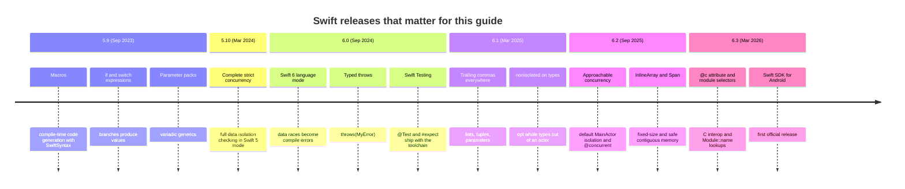

### V.2 Compatibility Matrix

| Swift | Released | Xcode | Language modes | Linux (official images) | Notes |
| --- | --- | --- | --- | --- | --- |
| 5.9 | Sep 2023 | 15.0 | 4, 4.2, 5 | Ubuntu 20.04, 22.04; Amazon Linux 2; CentOS 7; UBI 9 | Macros need SwiftSyntax as a package dependency. |
| 5.10 | Mar 2024 | 15.3 | 4, 4.2, 5 | Ubuntu 20.04, 22.04; Amazon Linux 2; UBI 9 | Last 5.x release; best base for preparing a Swift 6 migration. |
| 6.0 | Sep 2024 | 16.0 | 4, 4.2, 5, 6 | Ubuntu 20.04, 22.04, 24.04; Debian 12; Fedora 39; Amazon Linux 2; UBI 9 | Swift 6 mode is opt-in per target; `swift-tools-version: 6.0` makes 6 the default for new packages. |
| 6.1 | Mar 2025 | 16.3 | 4, 4.2, 5, 6 | Same platform family as 6.0 (see swift.org/install) | Package traits, more permissive trailing commas. |
| 6.2 | Sep 2025 | 26.0 | 4, 4.2, 5, 6 | Ubuntu 22.04, 24.04; Debian 12; Fedora; UBI 9 (see swift.org/install) | Approachable concurrency settings; WebAssembly SDK. |
| 6.3 | Mar 2026 | 26.x | 4, 4.2, 5, 6 | `swift:6.3-noble` and other official tags | Current stable when this guide was written; the starter targets it. |

Swift has no formal LTS. Each release replaces the previous one, and a new toolchain can always build code written for older language modes, so upgrading the compiler and upgrading the language mode are two separate steps.

### V.3 What's New in Swift 6.3

#### `@c`: expose Swift functions to C

Before 6.3 the only spelling was the underscored, unofficial `@_cdecl`. Now `@c` is the supported attribute, and the compiler writes a matching prototype into the generated C header.

```swift
// Before (unofficial, no header checking)
@_cdecl("todo_count")
public func todoCount() -> Int32 { 42 }

// Swift 6.3
@c(todo_count)
public func todoCount() -> Int32 { 42 }
```

`@c @implementation` goes the other way: the function is declared in an existing C header, and the compiler checks that the Swift body matches that declaration instead of generating a new one.

#### Module selectors with `::`

When two imported modules declare the same name, you can now say which module you mean at the use site.

```swift
import Metrics
import TodoCore

// Before: rename the import or qualify with the module name, which breaks
// when a type has the same name as its module.
let a = TodoCore.Counter()

// Swift 6.3: the module selector always means "look in this module".
let b = TodoCore::Counter()
let task = Swift::Task { 42 }   // the concurrency Task, even if you declared your own Task type
```

#### Performance attributes become official

`@specialize` (pre-built specialisations of a generic function for common types), `@inline(always)` and `@export(implementation)` replace their underscored forms. Use them only after a profiler shows the call is hot.

```swift
// Generate a specialised copy for [Int] and [Double] inside the library,
// so clients get fast code without seeing the generic body.
@specialize(where T == Int)
@specialize(where T == Double)
public func sum<T: AdditiveArithmetic>(_ values: [T]) -> T {
    values.reduce(.zero, +)
}
```

#### Swift Testing: warnings and cancellation

```swift
import Foundation
import Testing

@Test func slowPathStillWorks() throws {
    if ProcessInfo.processInfo.environment["CI_FAST"] != nil {
        try Test.cancel()   // 6.3: stop this test (and its child tasks) without failing it
    }
    Issue.record("cache was cold", severity: .warning)   // 6.3: reported, does not fail
    #expect(1 + 1 == 2)
}
```

#### Platform and tooling

- First official **Swift SDK for Android**: build packages for Android and call them from Kotlin through swift-java.
- An opt-in preview of **Swift Build** as SwiftPM's build engine, the same engine Xcode uses.
- `swift package show-traits` lists the traits a dependency offers.

### V.4 Migration Guide (Swift 5 mode → Swift 6 mode, toolchain 6.3)

Upgrade the toolchain first, keep the language mode, and fix warnings target by target.

```bash
# 1. Install the new toolchain and pin it for the project
swiftly install 6.3
swiftly use 6.3
echo "6.3" > .swift-version        # swiftly picks this up in the project directory

# 2. Build with the new compiler but the old language mode. Nothing should break.
swift build

# 3. Turn on complete concurrency checking as warnings, still in Swift 5 mode
swift build -Xswiftc -strict-concurrency=complete

# 4. Let SwiftPM apply mechanical fix-its for one upcoming feature at a time (SwiftPM 6.2+)
swift package migrate --to-feature ExistentialAny

# 5. Run the tests after every step
swift test
```

Then flip targets to Swift 6 mode in `Package.swift`, leaf modules first:

```swift
// swift-tools-version: 6.0      // 6.0+ tools: Swift 6 is the default language mode
import PackageDescription

let package = Package(
    name: "Legacy",
    targets: [
        .target(name: "Core"),                                  // already clean: Swift 6 mode
        .target(
            name: "UI",
            swiftSettings: [.swiftLanguageMode(.v5)]            // still migrating
        ),
    ]
)
```

| Step | What you change | What usually breaks |
| --- | --- | --- |
| Toolchain only | `swiftly use 6.3`, CI image tag | New warnings; deprecated APIs now warn. |
| `-strict-concurrency=complete` | Compiler flag | Non-`Sendable` captures in `Task {}`, global mutable `var`s, delegate callbacks off the main thread. |
| Swift 6 mode per target | `.swiftLanguageMode(.v6)` or tools 6.0 default | The warnings from the previous step become errors. |
| Approachable concurrency (6.2+) | `.defaultIsolation(MainActor.self)`, upcoming feature flags | Code that assumed `nonisolated async` functions hop to the global executor. |

### V.5 Deprecations & Breaking Changes

| Version | Deprecated / removed | Replacement | What breaks and how to fix it |
| --- | --- | --- | --- |
| 6.0 | `swiftLanguageVersions:` in `Package.swift` | `swiftLanguageModes:` | Warning only; rename the parameter. |
| 6.0 | `@UIApplicationMain`, `@NSApplicationMain` | `@main` | Error in Swift 6 mode; replace the attribute. |
| 6.0 | `@_implementationOnly import` | `internal import` (access-level imports, SE-0409) | Underscored attribute still works but is unsupported; switch to the access modifier. |
| 6.0 | Global and static mutable `var` without isolation | `let`, an actor, `@MainActor`, or `Mutex` | Swift 6 mode error: "var 'x' is not concurrency-safe because it is nonisolated global shared mutable state". |
| 6.0 | `Task.sleep(nanoseconds:)` as the main spelling | `Task.sleep(for: .milliseconds(20))` | Still compiles; the `Duration` form is clearer and clock-aware. |
| 6.0 | `NSLock`/`os_unfair_lock` wrappers for simple state | `Mutex` from the `Synchronization` module | No break; `Mutex` is `Sendable` and works on Linux. |
| 6.2 | Implicit hop of `nonisolated async` functions to the global executor (behind `NonisolatedNonsendingByDefault`) | Run on the caller's actor; mark offloaded work `@concurrent` | Only when you enable the feature: CPU-heavy async functions start running on the caller's actor. Add `@concurrent`. |
| 6.3 | `@_cdecl`, `@_specialize`, `@inline(__always)` | `@c`, `@specialize`, `@inline(always)` | Old spellings still compile; prefer the official ones in new code. |

---

## 📋 Table of Contents

- [🆕 Swift Versions, What's New & Migration](#-swift-versions-whats-new--migration)
- [1. Stage 1: Toolchain, Syntax & the Type System](#1-stage-1-toolchain-syntax--the-type-system)
  - [1.1 What Swift Is and Where It Runs](#11-what-swift-is-and-where-it-runs)
  - [1.2 Installing the Toolchain](#12-installing-the-toolchain)
  - [1.3 First Programs: Scripts, the REPL and `swift run`](#13-first-programs-scripts-the-repl-and-swift-run)
  - [1.4 Package Anatomy: the Starter Project Line by Line](#14-package-anatomy-the-starter-project-line-by-line)
  - [1.5 Constants, Variables and Type Inference](#15-constants-variables-and-type-inference)
  - [1.6 Strings, Characters and Unicode](#16-strings-characters-and-unicode)
  - [1.7 Optionals](#17-optionals)
  - [1.8 Control Flow as Expressions and Pattern Matching](#18-control-flow-as-expressions-and-pattern-matching)
  - [1.9 Tuples, Type Aliases and `print` Debugging](#19-tuples-type-aliases-and-print-debugging)
  - [1.10 Pitfalls](#110-pitfalls)
  - [1.11 Best Practices](#111-best-practices)
  - [1.12 Hands-on Exercise](#112-hands-on-exercise)
- [2. Stage 2: Functions, Closures, Collections & Packages](#2-stage-2-functions-closures-collections--packages)
  - [2.1 Functions: Labels, Defaults, Variadics and `inout`](#21-functions-labels-defaults-variadics-and-inout)
  - [2.2 Closures and Captures](#22-closures-and-captures)
  - [2.3 Array, Set and Dictionary](#23-array-set-and-dictionary)
  - [2.4 Higher-Order Functions and Lazy Sequences](#24-higher-order-functions-and-lazy-sequences)
  - [2.5 Enums with Associated Values](#25-enums-with-associated-values)
  - [2.6 Structs, Properties and Initialisers](#26-structs-properties-and-initialisers)
  - [2.7 Modules, Access Control and Dependencies](#27-modules-access-control-and-dependencies)
  - [2.8 Testing with Swift Testing](#28-testing-with-swift-testing)
  - [2.9 Pitfalls](#29-pitfalls)
  - [2.10 Best Practices](#210-best-practices)
  - [2.11 Hands-on Exercise](#211-hands-on-exercise)
- [3. Stage 3: Value Semantics, ARC, Protocols, Generics & Errors](#3-stage-3-value-semantics-arc-protocols-generics--errors)
  - [3.1 Value Types, Reference Types and Copy-on-Write](#31-value-types-reference-types-and-copy-on-write)
  - [3.2 ARC: Strong, Weak and Unowned References](#32-arc-strong-weak-and-unowned-references)
  - [3.3 Protocols, Extensions and Default Implementations](#33-protocols-extensions-and-default-implementations)
  - [3.4 Generics, Constraints and Key Paths](#34-generics-constraints-and-key-paths)
  - [3.5 `some` versus `any`: Opaque and Existential Types](#35-some-versus-any-opaque-and-existential-types)
  - [3.6 Error Handling: `throws`, Typed `throws`, `Result` and `defer`](#36-error-handling-throws-typed-throws-result-and-defer)
  - [3.7 Noncopyable Types and Ownership](#37-noncopyable-types-and-ownership)
  - [3.8 Memory Safety: Exclusivity, Unsafe Pointers and Strict Mode](#38-memory-safety-exclusivity-unsafe-pointers-and-strict-mode)
  - [3.9 Pitfalls](#39-pitfalls)
  - [3.10 Best Practices](#310-best-practices)
  - [3.11 Hands-on Exercise](#311-hands-on-exercise)
- [4. Stage 4: Structured Concurrency, Actors & Sendable](#4-stage-4-structured-concurrency-actors--sendable)
  - [4.1 `async`/`await` and Suspension Points](#41-asyncawait-and-suspension-points)
  - [4.2 Task Groups and Cancellation](#42-task-groups-and-cancellation)
  - [4.3 Actors and Reentrancy](#43-actors-and-reentrancy)
  - [4.4 `Sendable`, `@MainActor` and Swift 6 Mode](#44-sendable-mainactor-and-swift-6-mode)
  - [4.5 Pitfalls](#45-pitfalls)
  - [4.6 Best Practices](#46-best-practices)
- [5. Stage 5: I/O, Networking, Server-side Swift & Testing](#5-stage-5-io-networking-server-side-swift--testing)
  - [5.1 `Codable` and JSON](#51-codable-and-json)
  - [5.2 Routing and Request Handling in Hummingbird](#52-routing-and-request-handling-in-hummingbird)
  - [5.3 Testing an HTTP API in Memory](#53-testing-an-http-api-in-memory)
  - [5.4 Pitfalls](#54-pitfalls)
  - [5.5 Best Practices](#55-best-practices)
- [6. Stage 6: Performance, Security, Packaging & Deployment](#6-stage-6-performance-security-packaging--deployment)
  - [6.1 Build Configurations](#61-build-configurations)
  - [6.2 The Container Build](#62-the-container-build)
  - [6.3 Pitfalls](#63-pitfalls)
  - [6.4 Best Practices](#64-best-practices)
- [M1. Masterclass: Swift 6 Data-Race Safety & Approachable Concurrency](#m1-masterclass-swift-6-data-race-safety--approachable-concurrency)
  - [M1.1 How Isolation Checking Works](#m11-how-isolation-checking-works)
  - [M1.2 Swift 6.2 Approachable Concurrency](#m12-swift-62-approachable-concurrency)
  - [M1.3 Trade-offs](#m13-trade-offs)
  - [M1.4 Production Checklist](#m14-production-checklist)
- [M2. Masterclass: Macros with SwiftSyntax](#m2-masterclass-macros-with-swiftsyntax)
  - [M2.1 How Macro Expansion Works](#m21-how-macro-expansion-works)
  - [M2.2 Worked Example: Using `#expect` as a Macro](#m22-worked-example-using-expect-as-a-macro)
  - [M2.3 Trade-offs](#m23-trade-offs)
  - [M2.4 Production Checklist](#m24-production-checklist)
- [M3. Masterclass: Ownership, Noncopyable Types, `Span` and `InlineArray`](#m3-masterclass-ownership-noncopyable-types-span-and-inlinearray)
  - [M3.1 How Ownership Is Represented](#m31-how-ownership-is-represented)
  - [M3.2 Worked Example](#m32-worked-example)
  - [M3.3 Trade-offs](#m33-trade-offs)
  - [M3.4 Production Checklist](#m34-production-checklist)
- [M4. Masterclass: C and C++ Interoperability](#m4-masterclass-c-and-c-interoperability)
  - [M4.1 How the Clang Importer Works](#m41-how-the-clang-importer-works)
  - [M4.2 Worked Example](#m42-worked-example)
  - [M4.3 Trade-offs](#m43-trade-offs)
  - [M4.4 Production Checklist](#m44-production-checklist)
- [M5. Masterclass: Flagship Blueprint: A Production Todo Service](#m5-masterclass-flagship-blueprint-a-production-todo-service)
  - [M5.1 Architecture](#m51-architecture)
  - [M5.2 Worked Example](#m52-worked-example)
  - [M5.3 Trade-offs](#m53-trade-offs)
  - [M5.4 Production Checklist](#m54-production-checklist)
- [7. Stage 7: Staff Swift Engineer Interview Handbook & Cheatsheet](#7-stage-7-staff-swift-engineer-interview-handbook--cheatsheet)
  - [7.1 Core Concepts (Q1-Q10)](#71-core-concepts-q1-q10)
  - [7.2 Internals & Performance (Q11-Q14)](#72-internals--performance-q11-q14)
  - [7.5 Staff Cheatsheet](#75-staff-cheatsheet)
- [🧪 Example Projects](#-example-projects)
- [📝 Cheat Sheets](#-cheat-sheets)
- [📚 Resources](#-resources)
- [🤝 Contributing](#-contributing)
- [📄 License](#-license)
- [🙏 Acknowledgments](#-acknowledgments)
- [🌐 Connect with me](#-connect-with-me)
- [☕ Support](#-support)

---

## 1. Stage 1: Toolchain, Syntax & the Type System

This stage installs a Swift toolchain on macOS, Linux, Windows or Docker, runs the starter package, and covers the syntax you need to read it: constants and variables, the core value types, strings, optionals, and control flow that produces values. You need a terminal and a text editor; no Apple hardware is required. When you finish, you can build, run and test a Swift package from the command line and explain every line of `Sources/TodoCore`.

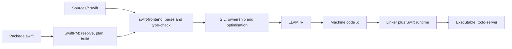

### 1.1 What Swift Is and Where It Runs

Swift is a compiled, statically typed, memory-safe language. Apple created it in 2014 to replace Objective-C, open-sourced it in 2015, and today it is developed in the open by the Swift project with an evolution process (`SE-NNNN` proposals) that anyone can follow. It compiles to native code through LLVM, so there is no virtual machine and no garbage collector. Memory is managed with automatic reference counting (ARC) for classes, and most everyday types (`Int`, `String`, `Array`, your own structs) are value types that need no reference counting at all.

Swift runs on more than iPhones. The same compiler targets macOS, iOS, watchOS, tvOS and visionOS, Linux (x86_64 and arm64), Windows, Android (official SDK since 6.3), WebAssembly (SDK since 6.2), and microcontrollers through Embedded Swift. Server-side Swift is a mature niche: SwiftNIO, Vapor and Hummingbird power production services, and the official Docker images make Linux builds routine.

| Concern | Swift | Kotlin / Java | Go | Rust |
| --- | --- | --- | --- | --- |
| Memory management | ARC for classes, values for everything else | Tracing GC | Tracing GC | Ownership and borrowing, no runtime counting |
| Null safety | `Optional<T>` checked at compile time | Kotlin: nullable types; Java: none | Zero values, `nil` pointers | `Option<T>` |
| Data-race safety | Compile-time in Swift 6 mode (actors, `Sendable`) | Runtime discipline | Race detector at runtime | Compile-time (`Send`, `Sync`) |
| Generics | Reified at runtime, specialised by the optimiser | Erased (JVM) | Type parameters, stenciled | Monomorphised |
| Typical niche | Apple platforms, servers, embedded | Android, backend | Cloud services, CLIs | Systems, infrastructure |

The main trade-off: Swift gives you most of Rust's safety with a gentler learning curve, at the cost of some runtime overhead from ARC and existential boxing that you learn to avoid in Stage 6.

### 1.2 Installing the Toolchain

A toolchain is the compiler (`swiftc`), the package manager (`swift build`, `swift test`, `swift package`), the standard library, Foundation, Swift Testing, XCTest, `swift-format`, `sourcekit-lsp` for editors, and LLDB.

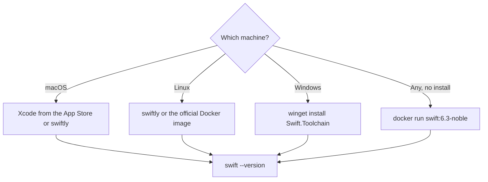

```bash
# macOS and Linux: swiftly is the official toolchain manager
curl -O https://download.swift.org/swiftly/darwin/swiftly.pkg   # macOS installer
# Linux: follow swift.org/install, which gives a one-line installer per distro

swiftly install latest        # installs the current stable toolchain
swiftly list                  # shows installed toolchains
swiftly use 6.3               # switches the active one
swift --version               # prints "Swift version 6.3 ..."

# Windows (PowerShell): the toolchain also needs the Visual Studio C++ build tools
winget install --id Swift.Toolchain -e

# Any OS with Docker: nothing to install on the host
docker run --rm -it -v "$PWD:/src" -w /src swift:6.3-noble swift test
```

Editor setup: Xcode on macOS, or VS Code with the official Swift extension (`swiftlang.swift-vscode`), which uses `sourcekit-lsp` for completion and runs tests from the sidebar. Any editor that speaks LSP works the same way.

### 1.3 First Programs: Scripts, the REPL and `swift run`

Swift has three ways to execute code, and they behave differently at the top level.

```swift
// hello.swift: run with `swift hello.swift`
// In a single-file script (or a file named main.swift), top-level statements run in order.
let name = CommandLine.arguments.dropFirst().first ?? "world"
print("Hello, \(name)!")
```

```bash
swift hello.swift Ada          # interpret-and-run a script: Hello, Ada!
swiftc -O hello.swift -o hello # compile to a native binary
./hello Grace                  # Hello, Grace!
swift repl                     # interactive REPL (LLDB-based)
```

In a package, the executable target has either a `main.swift` file with top-level code or exactly one type marked `@main`. The starter uses `@main` because it needs an `async` entry point:

```swift
// Sources/TodoServer/App.swift
import Foundation
import TodoAPI
import TodoCore

@main
struct App {
    static func main() async throws {
        let config = ServerConfig(environment: ProcessInfo.processInfo.environment)
        let app = buildApplication(config: config, repository: InMemoryTodoRepository())
        // runService() starts the server and handles SIGINT/SIGTERM for a clean shutdown.
        try await app.runService()
    }
}
```

| Line / API | Role | What happens at runtime |
| :--- | :--- | :--- |
| `import Foundation` | Brings in `ProcessInfo` | On Linux this is swift-foundation, linked statically in the Docker build. |
| `@main struct App` | Marks the program entry point | The compiler generates a real `main` symbol that calls `App.main()`. |
| `static func main() async throws` | Async entry point | The runtime starts a main task and runs it on the main actor's executor. An uncaught error prints and exits non-zero. |
| `ServerConfig(environment:)` | Reads `HOST` and `PORT` | Pure function of a dictionary, so tests can call it with `[:]`. |
| `buildApplication(...)` | Wires the router and repository | Nothing listens yet; it only builds values. |
| `try await app.runService()` | Starts the HTTP server | Binds `0.0.0.0:8080`, serves until SIGTERM, then shuts down gracefully. |

### 1.4 Package Anatomy: the Starter Project Line by Line

Every non-trivial Swift project is a SwiftPM package: a `Package.swift` manifest plus `Sources/<Target>/` and `Tests/<TestTarget>/` folders. The starter in this repo is laid out like this:

```text
learn-swift/
├── Package.swift              manifest (Swift code that describes the build)
├── Package.resolved           lockfile: exact dependency versions, committed
├── .swift-format              formatter and linter settings
├── Sources/
│   ├── TodoCore/              domain: Todo, Priority, TodoDraft, TodoQuery, TodoStats, repository
│   ├── TodoAPI/               HTTP: routes, response bodies, ServerConfig
│   └── TodoServer/App.swift   executable entry point
└── Tests/
    ├── TodoCoreTests/         Swift Testing suites for the domain
    └── TodoAPITests/          in-memory HTTP tests with HummingbirdTesting
```

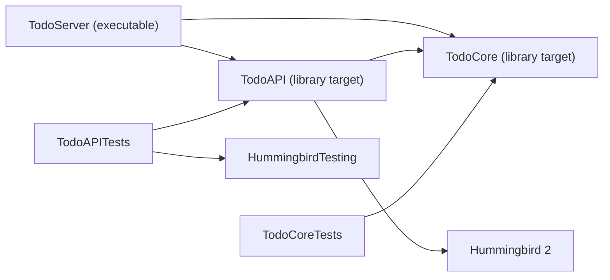

```swift
// swift-tools-version: 6.0
import PackageDescription

let package = Package(
    name: "TodoService",
    platforms: [
        .macOS(.v14)
    ],
    products: [
        .executable(name: "todo-server", targets: ["TodoServer"])
    ],
    dependencies: [
        .package(url: "https://github.com/hummingbird-project/hummingbird.git", from: "2.0.0")
    ],
    targets: [
        .target(name: "TodoCore"),
        .target(
            name: "TodoAPI",
            dependencies: [
                "TodoCore",
                .product(name: "Hummingbird", package: "hummingbird"),
            ]
        ),
        .executableTarget(name: "TodoServer", dependencies: ["TodoAPI", "TodoCore"]),
        .testTarget(name: "TodoCoreTests", dependencies: ["TodoCore"]),
        .testTarget(
            name: "TodoAPITests",
            dependencies: [
                "TodoAPI",
                "TodoCore",
                .product(name: "HummingbirdTesting", package: "hummingbird"),
            ]
        ),
    ]
)
```

| Line / API | Role | What happens at runtime |
| :--- | :--- | :--- |
| `// swift-tools-version: 6.0` | Minimum SwiftPM version, and the default language mode | Must be the first line. 6.0 means every target compiles in Swift 6 mode unless it opts out. |
| `platforms: [.macOS(.v14)]` | Minimum deployment target on Apple platforms | Ignored on Linux. Hummingbird 2 needs macOS 14 APIs. |
| `products` | What other packages (or `swift run`) can use | `swift run todo-server` builds and runs this product. |
| `.package(url:from:)` | Remote dependency with a semantic-version range | `from: "2.0.0"` allows any 2.x. The exact version lands in `Package.resolved`. |
| `.target(name: "TodoCore")` | A library module | Sources come from `Sources/TodoCore` by convention. Becomes `import TodoCore`. |
| `.product(name:package:)` | A product from a dependency | The `package:` value is the dependency's identity, the last path part of its URL in lowercase. |
| `.executableTarget` | A module with an entry point | Linked into a binary. |
| `.testTarget` | A test bundle | Discovered and run by `swift test`. |

Run it:

```bash
swift build                     # debug build into .build/debug
swift test                      # build and run both test targets
swift run todo-server           # start the server on :8080
curl -s localhost:8080/health   # ok
curl -s -X POST localhost:8080/todos -d '{"title":"Learn Swift","tags":["swift"]}'
curl -s 'localhost:8080/todos?priority=normal'
```

### 1.5 Constants, Variables and Type Inference

`let` declares a constant, `var` a variable. Prefer `let`: the compiler warns when a `var` is never mutated. Types are inferred from the initial value, and once a name has a type it never changes.

```swift
// types.swift: run with `swift types.swift`
let maxTags = 5                 // Int, inferred
var title = "Learn Swift"       // String
title += " 6"                   // fine: var
// maxTags = 6                  // error: cannot assign to value: 'maxTags' is a 'let' constant

let ratio: Double = 3           // annotation turns the literal 3 into a Double
let percent = 7 * 100 / 9       // Int division: 77
let precise = Double(7) * 100 / 9  // 77.77...
// let mixed = maxTags * ratio  // error: binary operator '*' cannot be applied to 'Int' and 'Double'

let big = Int.max               // 9223372036854775807 on 64-bit platforms
let wrapped = big &+ 1          // &+ wraps on overflow: Int.min
// let crash = big + 1          // traps at runtime: arithmetic overflow

let million = 1_000_000         // underscores for readability
let hex = 0xFF, binary = 0b1010
print(percent, precise, wrapped, million, hex, binary)
```

Swift never converts numbers implicitly. `Int` and `Double` mix only through an explicit initialiser. Integer overflow traps instead of wrapping silently, which turns a class of security bugs into crashes you can see; the `&+`, `&-` and `&*` operators opt into wrapping when you really want it.

| Type | Size | Notes |
| --- | --- | --- |
| `Int`, `UInt` | Platform word (64-bit on all current platforms) | Use `Int` for counts and indices even when values are never negative. |
| `Int8` ... `Int64`, `Int128` (6.0) | Fixed | For binary formats and interop. |
| `Double`, `Float`, `Float16` | 64, 32, 16 bits | `Double` is the default for floating literals. |
| `Bool` | 1 byte | No truthiness: `if count {}` does not compile. |
| `String`, `Character` | Variable | Unicode-correct; see 1.6. |

### 1.6 Strings, Characters and Unicode

A Swift `String` is a collection of `Character`s, and a `Character` is an extended grapheme cluster: what a reader sees as one character. That makes `count` correct for emoji and accents, but it means strings cannot be indexed with integers.

```swift
// strings.swift
let word = "café"
let accented = "e\u{301}"            // "e" followed by a combining acute accent
print(word.count, word.utf8.count)    // 4 5   ("é" is 2 UTF-8 bytes)
print(accented.count, accented.unicodeScalars.count)  // 1 2   (one visible character, two scalars)
print(accented == "é")                // true: comparison uses canonical equivalence

// Indices are opaque String.Index values, not Ints.
let first = word[word.startIndex]                       // "c"
let third = word[word.index(word.startIndex, offsetBy: 2)]  // "f"
// word[2]   // error: 'subscript(_:)' is unavailable: cannot subscript String with an Int

// Slicing returns a Substring that shares storage with the original.
let prefix: Substring = word.prefix(3)   // "caf"
let owned = String(prefix)               // copy when you keep it around

// Multi-line and raw strings
let json = #"{"title": "Ship it", "tags": ["swift"]}"#   // no escaping inside #"..."#
let help = """
    Usage: todo-server
      PORT  port to listen on (default 8080)
    """
print(first, third, owned, json, help, separator: "\n")
```

The starter trims whitespace without Foundation by walking indices. This is the idiomatic way to slice a string:

```swift
extension StringProtocol {
    /// The string without leading or trailing whitespace, without Foundation.
    var trimmed: String {
        guard let start = firstIndex(where: { !$0.isWhitespace }),
            let end = lastIndex(where: { !$0.isWhitespace })
        else { return "" }
        return String(self[start...end])
    }
}
```

| Line / API | Role | What happens at runtime |
| :--- | :--- | :--- |
| `extension StringProtocol` | Adds a member to both `String` and `Substring` | One implementation serves both types. |
| `firstIndex(where:)` | Scans from the front | Returns `String.Index?`; `nil` when every character is whitespace. |
| `guard let ... else { return "" }` | Early exit | The all-whitespace case returns an empty string. |
| `self[start...end]` | Closed-range subscript | Produces a `Substring` with no copy. |
| `String(...)` | Materialises the result | Copies the bytes once, so the result does not keep the original alive. |

### 1.7 Optionals

An optional `T?` is either a value of type `T` or `nil`. It is an ordinary enum, `Optional<T>` with cases `.some(T)` and `.none`, so the compiler forces you to handle the missing case before you use the value.

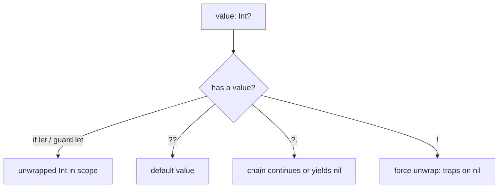

```swift
// optionals.swift
let rawPort: String? = "8080"
let port: Int? = rawPort.flatMap { Int($0) }   // Int("abc") would be nil

if let port {                       // shorthand for `if let port = port` (Swift 5.7+)
    print("listening on", port)
}

func describe(_ tag: String?) -> String {
    guard let tag, !tag.isEmpty else { return "untagged" }   // early exit keeps the happy path flat
    return "#\(tag)"
}

let count = ["swift": 3]["kotlin"] ?? 0          // dictionary lookups return optionals
let upper = Optional("swift")?.uppercased()      // optional chaining: "SWIFT"
let length = upper.map(\.count)                  // map over an optional: Optional(5)

switch port {                                    // optionals pattern-match like any enum
case .some(let p) where p < 1024: print("privileged")
case .some: print("user port")
case .none: print("no port")
}
print(describe(nil), describe("ios"), count, length ?? 0)
```

The starter's `ServerConfig` chains three optional steps into one condition: the variable exists, it parses as an `Int`, and it is in range.

```swift
if let raw = environment["PORT"], let port = Int(raw), (1...65_535).contains(port) {
    self.port = port
} else {
    self.port = Self.defaultPort
}
```

Force unwrapping (`value!`) and implicitly unwrapped optionals (`var x: Int!`) crash on `nil` with "Unexpectedly found nil while unwrapping an Optional value". Reserve them for values that are a programming error to be missing, such as a resource bundled with the app, and prefer `guard let ... else { fatalError("why") }` so the crash explains itself.

### 1.8 Control Flow as Expressions and Pattern Matching

Since Swift 5.9, `if` and `switch` can produce a value. A `switch` must be exhaustive, which is what makes enums safe to extend: adding a case breaks every switch that forgot it, at compile time.

```swift
// control.swift
enum Priority: String, CaseIterable { case low, normal, high, urgent }

func rank(_ p: Priority) -> Int {
    switch p {                      // switch expression: each branch is a value
    case .low: 0
    case .normal: 1
    case .high: 2
    case .urgent: 3
    }
}

let hour = 14
let greeting = if hour < 12 { "morning" } else if hour < 18 { "afternoon" } else { "evening" }

let point = (x: 3, y: 0)
switch point {
case (0, 0): print("origin")
case (_, 0): print("on the x axis")              // _ matches anything
case let (x, y) where x == y: print("diagonal")  // binding plus a guard
case (-5...5, -5...5): print("near the origin")  // ranges are patterns
default: print("far away")
}

for p in Priority.allCases where rank(p) >= 2 {   // filtered loop
    print(p.rawValue)
}
for (index, p) in Priority.allCases.enumerated() { print(index, p) }
var countdown = 3
while countdown > 0 { countdown -= 1 }
repeat { countdown += 1 } while countdown < 2
print(greeting, countdown)
```

`for`-`in` works with any `Sequence`, `stride(from:to:by:)` replaces C-style loops, and labelled statements (`outer: for ...` with `break outer`) exit nested loops.

### 1.9 Tuples, Type Aliases and `print` Debugging

Tuples group values without declaring a type. They are handy for returning two things from a function, but once a tuple travels across more than one function, make it a struct.

```swift
// tuples.swift
typealias Range2D = (min: Int, max: Int)

func minMax(_ values: [Int]) -> Range2D? {
    guard var lo = values.first else { return nil }
    var hi = lo
    for v in values.dropFirst() {
        lo = min(lo, v)
        hi = max(hi, v)
    }
    return (lo, hi)
}

if let r = minMax([4, 9, -2, 7]) {
    print(r.min, r.max)              // -2 9
    let (lo, hi) = r                 // destructuring
    print(hi - lo)                   // 11
}
dump(minMax([1]))                    // dump prints nested structure, useful in scripts
debugPrint("quoted \"string\"")      // shows escapes and quotes
```

### 1.10 Pitfalls

| Pitfall | Symptom | Fix |
| --- | --- | --- |
| Subscripting a `String` with an `Int` | `error: 'subscript(_:)' is unavailable: cannot subscript String with an Int` | Use `index(_:offsetBy:)`, `prefix`, `dropFirst`, or convert to `Array(string)` for heavy random access. |
| Force-unwrapping user input | `Fatal error: Unexpectedly found nil while unwrapping an Optional value` | `guard let` or `??` with a default; validate at the boundary. |
| Mixing `Int` and `Double` | `binary operator '*' cannot be applied to operands of type 'Int' and 'Double'` | Convert explicitly: `Double(count) * ratio`. |
| Integer overflow in arithmetic | `Thread 1: Swift runtime failure: arithmetic overflow` (trap) | Use a wider type, check with `addingReportingOverflow`, or use `&+` when wrapping is intended. |
| Keeping a `Substring` long-term | Memory stays high: the slice keeps the whole original string alive | Convert with `String(substring)` before storing. |
| Top-level code in a file not named `main.swift` | `error: expressions are not allowed at the top level` | Move code into `main.swift` or a `@main` type. |
| `@main` and `main.swift` in the same target | `error: 'main' attribute cannot be used in a module that contains top-level code` | Keep exactly one entry point per executable target. |
| Wrong `package:` name in `.product(name:package:)` | `error: unknown package 'Hummingbird' in dependencies of target` | Use the package identity: the lowercase last path part of the URL (`hummingbird`). |

### 1.11 Best Practices

- **Default to `let`**: immutable bindings make data flow obvious and let the compiler optimise copies.
- **Let inference work, annotate at boundaries**: write types on public APIs and stored properties; skip them on local variables where the right-hand side is obvious.
- **Treat `!` as an assertion**: every force unwrap is a claim that `nil` is impossible; if you cannot defend the claim in a code review, unwrap safely.
- **Use `guard` for preconditions**: early exits keep the main path unindented and make every failure case visible at the top of the function.
- **Pin the toolchain**: commit `.swift-version` and use the same `swift:<version>` image in CI and Docker so local and CI builds agree.
- **Keep the domain free of frameworks**: `TodoCore` imports nothing, so it compiles fast, tests fast, and can be reused by a CLI or an iOS app.

### 1.12 Hands-on Exercise

Add a `GET /todos/stats` route that returns only the `TodoStats` for all to-dos.

1. In `Sources/TodoAPI/Responses.swift`, make `TodoStats` returnable by wrapping it: `public struct StatsBody: ResponseCodable { public let stats: TodoStats }`.
2. In `Sources/TodoAPI/Routes.swift`, register the route **before** `/todos/:id` and return `StatsBody(stats: TodoStats(await repository.all()))`.
3. Add a test in `Tests/TodoAPITests/RouteTests.swift` that creates two to-dos, marks one done, and expects `completionPercent == 50` in the decoded body.

Expected output of `curl -s localhost:8080/todos/stats` after creating two to-dos and completing one (Foundation's `JSONEncoder` does not sort keys, so the order may differ):

```json
{"stats":{"total":2,"done":1,"byPriority":{"normal":2}}}
```

The building blocks (`TodoStats`, `buildRouter`, the decode helper in `RouteTests`) are already in the starter; the solution is about ten lines.

[Back to top ⤴️](#-table-of-contents)

---

## 2. Stage 2: Functions, Closures, Collections & Packages

Stage 2 is about organising code: functions with clear call sites, closures and what they capture, the three standard collections and the higher-order functions that replace most loops, enums that carry data, properties, and modules with access control. It ends with Swift Testing, so every later stage can be test-driven. Prerequisite: Stage 1. Afterwards you can split a program into SwiftPM targets with a deliberate public API and cover it with parameterised tests.

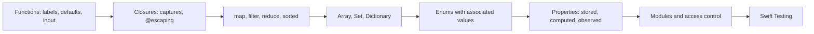

### 2.1 Functions: Labels, Defaults, Variadics and `inout`

Every parameter has an **argument label** (used at the call site) and a **parameter name** (used in the body). Good labels make calls read as English phrases, which is the core of the Swift API Design Guidelines.

```swift
// functions.swift
func move(_ title: String, from source: String, to destination: String) -> String {
    "\(title): \(source) -> \(destination)"
}
print(move("Ship 1.0", from: "todo", to: "done"))    // reads like a sentence

func greet(_ name: String, punctuation: String = "!") -> String {   // default value
    "Hello, \(name)\(punctuation)"
}
print(greet("Ada"), greet("Grace", punctuation: "?"))

func average(_ values: Double...) -> Double {         // variadic: values is [Double]
    values.isEmpty ? 0 : values.reduce(0, +) / Double(values.count)
}
print(average(1, 2, 3, 4))                             // 2.5

func bump(_ counter: inout Int, by step: Int = 1) {   // inout: copy in, copy back out
    counter += step
}
var hits = 0
bump(&hits)                                            // & marks the mutation at the call site
bump(&hits, by: 10)
print(hits)                                            // 11

@discardableResult                                     // callers may ignore the result
func log(_ message: String) -> Int { print(message); return message.count }
log("no warning about the unused Int")
```

| Feature | Rule | Why it matters |
| --- | --- | --- |
| `_` label | Omit the label at the call site | Use when the first argument completes the base name: `contains(x)`, `append(x)`. |
| Default values | Must be constant expressions or calls | Replaces most overloads. |
| `inout` | Caller writes `&x`; value is copied in and written back | Exclusivity: two `inout` accesses to the same variable at once is a compile error or a runtime trap (Stage 3.8). |
| Return type omitted | Means `-> Void` | Single-expression bodies return implicitly. |
| `throws`, `async` | Part of the function's type | `try` and `await` mark every call that can throw or suspend. |

### 2.2 Closures and Captures

A closure is a function value. Swift lets you shorten closures step by step: drop types the compiler can infer, use `$0` for parameters, and move the last closure argument outside the parentheses (trailing closure syntax).

```swift
// closures.swift
let titles = ["deploy", "Write docs", "fix bug"]

let a = titles.sorted(by: { (lhs: String, rhs: String) -> Bool in lhs < rhs })  // full form
let b = titles.sorted { lhs, rhs in lhs < rhs }    // inferred types, trailing closure
let c = titles.sorted { $0.lowercased() < $1.lowercased() }   // shorthand arguments
let d = titles.sorted(by: <)                       // an operator is a function too
print(a == b, c, d)

// Closures capture variables by reference, not by value.
func makeCounter() -> () -> Int {
    var count = 0
    return {                     // this closure captures `count` and keeps it alive
        count += 1
        return count
    }
}
let next = makeCounter()
print(next(), next(), next())    // 1 2 3

// A capture list copies the value at creation time instead.
var label = "before"
let printLabel = { [label] in print(label) }
label = "after"
printLabel()                     // before
```

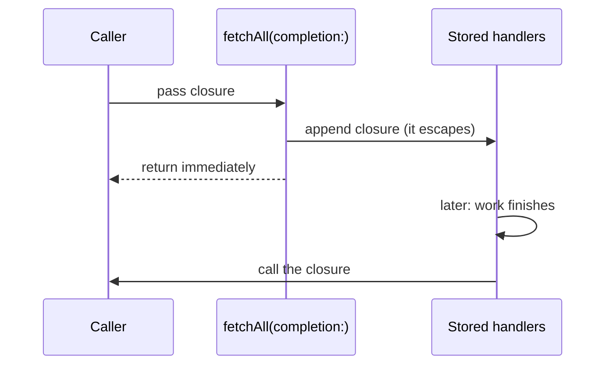

A closure parameter is **non-escaping** by default: the function promises to call it (or not) before returning. If the function stores the closure or calls it later, the parameter must be marked `@escaping`, and the compiler then requires explicit `self.` inside class-based closures so you notice possible retain cycles (Stage 3.2).

```swift
final class Notifier {
    private var handlers: [(String) -> Void] = []

    func onChange(_ handler: @escaping (String) -> Void) {   // stored, so @escaping
        handlers.append(handler)
    }

    func send(_ event: String) {
        handlers.forEach { $0(event) }                         // non-escaping use
    }
}

let notifier = Notifier()
notifier.onChange { print("got", $0) }
notifier.send("todo.created")
```

### 2.3 Array, Set and Dictionary

The three standard collections are generic structs with value semantics. Copying a collection is cheap because the storage is shared until one copy is mutated (copy-on-write, explained in depth in 3.1).

```swift
// collections.swift
var tags: [String] = ["swift", "ios"]          // Array: ordered, duplicates allowed
tags.append("server")
tags.insert("linux", at: 0)
tags += ["swift"]
print(tags.count, tags.first ?? "-", tags.last ?? "-")
if tags.indices.contains(10) { print(tags[10]) }   // out-of-range subscripts trap, so check

var unique: Set<String> = Set(tags)             // Set: unordered, unique, O(1) contains
unique.insert("swift")                          // returns (inserted: false, ...)
let backend: Set = ["server", "linux", "docker"]
print(unique.intersection(backend).sorted())    // ["linux", "server"]
print(unique.isSuperset(of: ["swift", "ios"]))  // true

var counts: [String: Int] = [:]                 // Dictionary: key-value, unordered
for tag in tags { counts[tag, default: 0] += 1 }   // default subscript avoids optional dance
print(counts["swift"] ?? 0)                     // 2
counts["ios"] = nil                             // assigning nil removes the key
for (tag, n) in counts.sorted(by: { $0.key < $1.key }) { print(tag, n) }

let grouped = Dictionary(grouping: tags, by: \.count)   // [Int: [String]]
print(grouped[5] ?? [])                         // ["linux", "swift", "swift"]
```

| Operation | `Array` | `Set` | `Dictionary` |
| --- | --- | --- | --- |
| Lookup by position or key | O(1) `a[i]` | n/a | O(1) average `d[k]` |
| `contains` | O(n) | O(1) average | O(1) on keys |
| Insert | O(1) amortised at the end, O(n) in the middle | O(1) average | O(1) average |
| Order | Insertion order | None (changes between runs) | None (changes between runs) |
| Element requirement | Any type | `Hashable` | `Hashable` keys |

Hash iteration order is randomised per process (per-process hash seeding), which is why the starter's `InMemoryTodoRepository.all()` sorts by id before returning: tests and API clients get a stable order.

### 2.4 Higher-Order Functions and Lazy Sequences

Most loops over collections are a `map`, `filter`, `reduce`, `compactMap`, `flatMap`, `first(where:)`, `contains(where:)`, `allSatisfy` or `sorted`. Naming the operation states the intent.

```swift
// higher_order.swift
struct Todo { let id: Int; let title: String; let isDone: Bool; let estimate: Int? }
let todos = [
    Todo(id: 1, title: "Write tests", isDone: true, estimate: 3),
    Todo(id: 2, title: "Ship", isDone: false, estimate: nil),
    Todo(id: 3, title: "Docs", isDone: false, estimate: 2),
]

let open = todos.filter { !$0.isDone }                 // [Todo]
let titles = open.map(\.title)                         // key path as a function: ["Ship", "Docs"]
let estimates = todos.compactMap(\.estimate)           // drops nils: [3, 2]
let total = estimates.reduce(0, +)                     // 5
let doneCount = todos.count(where: \.isDone)           // Swift 6.0: 1
let firstOpen = todos.first { !$0.isDone }?.title      // "Ship"
let allEstimated = todos.allSatisfy { $0.estimate != nil }   // false
let words = todos.flatMap { $0.title.split(separator: " ") } // ["Write", "tests", "Ship", "Docs"]
print(titles, total, doneCount, firstOpen ?? "-", allEstimated, words)

// lazy: nothing runs until an element is requested, and only as much as needed.
let firstBigSquare = (1...).lazy.map { $0 * $0 }.first { $0 > 1_000 }
print(firstBigSquare ?? 0)                             // 1024, without an infinite loop
```

The starter's `TodoStats` is built from these pieces in three lines:

```swift
public init(_ todos: [Todo]) {
    total = todos.count
    done = todos.count(where: \.isDone)
    byPriority = Dictionary(grouping: todos, by: \.priority.rawValue).mapValues(\.count)
}
```

`TodoQuery.apply(to:)` shows a filter followed by a two-key sort, using the query's own method as the predicate:

```swift
public func apply(to todos: some Sequence<Todo>) -> [Todo] {
    todos.filter(matches).sorted { lhs, rhs in
        lhs.priority != rhs.priority ? lhs.priority > rhs.priority : lhs.id < rhs.id
    }
}
```

| Line / API | Role | What happens at runtime |
| :--- | :--- | :--- |
| `some Sequence<Todo>` | Accepts any sequence of `Todo` (array, set, lazy view) | The compiler generates one specialised copy per concrete type; no boxing. |
| `filter(matches)` | Passes a method as a closure | `matches` is `(Todo) -> Bool`, exactly the type `filter` wants. |
| `sorted { ... }` | Comparison closure | Introsort, O(n log n); `sorted` is not guaranteed stable, so the id tie-breaker makes the order deterministic. |

### 2.5 Enums with Associated Values

Swift enums are sum types: each case can carry its own payload. They model states and results far better than a struct with a bag of optional fields, because impossible combinations cannot be represented.

```swift
// enums.swift
enum Command {
    case add(title: String, tags: [String])
    case complete(id: Int)
    case delete(id: Int)
    case list(includeDone: Bool)
}

func parse(_ words: [String]) -> Command? {
    switch words.first {
    case "add" where words.count > 1: .add(title: words[1], tags: Array(words.dropFirst(2)))
    case "done": words.dropFirst().first.flatMap(Int.init).map { Command.complete(id: $0) }
    case "rm": words.dropFirst().first.flatMap(Int.init).map(Command.delete)
    case "ls": .list(includeDone: words.contains("--all"))
    default: nil
    }
}

for input in ["add Ship swift", "done 3", "rm x", "ls --all"] {
    switch parse(input.split(separator: " ").map(String.init)) {
    case .add(let title, let tags)?: print("add", title, tags)
    case .complete(let id)?, .delete(let id)?: print("touch", id)   // shared binding
    case .list(let all)?: print("list, all:", all)
    case nil: print("could not parse:", input)
    }
}

// indirect enums can refer to themselves: a tiny expression tree
indirect enum Expr {
    case number(Int)
    case add(Expr, Expr)
    case multiply(Expr, Expr)

    var value: Int {
        switch self {
        case .number(let n): n
        case .add(let l, let r): l.value + r.value
        case .multiply(let l, let r): l.value * r.value
        }
    }
}
print(Expr.add(.number(2), .multiply(.number(3), .number(4))).value)   // 14
```

Raw-value enums (`enum Priority: String`) are the other flavour: each case maps to a literal, which gives you `init?(rawValue:)` and free `Codable` support. The starter's `Priority` uses this, and `TodoQuery` turns a query-string value into a case with `priority.flatMap(Priority.init(rawValue:))`, so an unknown value is simply `nil`.

### 2.6 Structs, Properties and Initialisers

Structs are the default building block. You get a memberwise initialiser for free (internal access only), and you add stored, computed, lazy and observed properties as needed.

```swift
// properties.swift
struct Timer {
    let label: String                         // stored constant
    var elapsed: Double = 0 {                 // stored variable with observers
        willSet { if newValue < elapsed { print("going back in time?") } }
        didSet { history.append(oldValue) }
    }
    private(set) var history: [Double] = []   // readable outside, writable only inside

    var minutes: Double { elapsed / 60 }       // computed, read-only

    var formatted: String {                    // computed with getter and setter
        get { "\(label): \(Int(elapsed))s" }
        set { elapsed = Double(newValue.split(separator: " ").last?.dropLast() ?? "0") ?? 0 }
    }

    static let zero = Timer(label: "zero")     // type property, lazily initialised once

    mutating func tick() { elapsed += 1 }      // mutating: changes self, needs a var instance
}

var t = Timer(label: "build")                  // memberwise init with defaults
t.tick(); t.tick()
print(t.formatted, t.history)                  // build: 2s [0.0, 1.0]
let frozen = Timer.zero
// frozen.tick()                               // error: cannot use mutating member on immutable value
print(frozen.minutes)
```

The starter's `Todo` writes its initialiser by hand because the memberwise one is `internal`, and a `public` type used from another module needs a `public init`. That is one of the first surprises when you split code into modules.

```swift
public struct Todo: Sendable, Hashable, Codable, Identifiable {
    public let id: Int
    public var title: String
    public var priority: Priority
    public var tags: Set<String>
    public var isDone: Bool

    public init(id: Int, title: String, priority: Priority = .normal,
                tags: Set<String> = [], isDone: Bool = false) {
        self.id = id
        self.title = title
        self.priority = priority
        self.tags = tags
        self.isDone = isDone
    }
}
```

| Conformance | What you get | Synthesised when |
| --- | --- | --- |
| `Equatable` | `==` | Every stored property is `Equatable`. |
| `Hashable` | `hash(into:)`, use as `Set` element or `Dictionary` key | Every stored property is `Hashable`. |
| `Codable` | JSON (and other formats) encoding and decoding | Every stored property is `Codable`; `CodingKeys` can rename fields. |
| `Identifiable` | `id` requirement used by SwiftUI and diffing | You declare `id`. |
| `Sendable` | Safe to pass between concurrency domains | Implicit for non-public structs whose properties are `Sendable`; public types must state it. |

### 2.7 Modules, Access Control and Dependencies

Each SwiftPM target is a **module**: a unit of compilation with its own namespace. Access control is enforced at module and file boundaries.

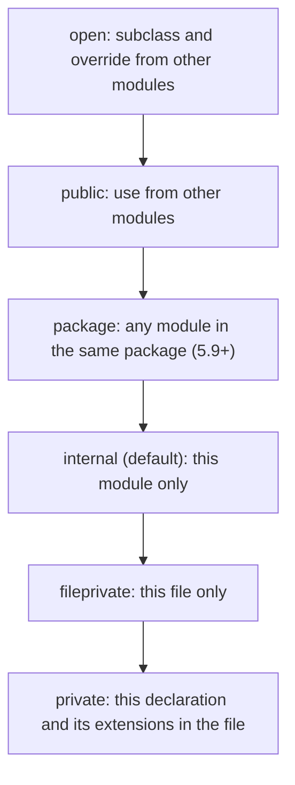

```swift
// Sources/TodoCore/Priority.swift
public enum Priority: String, Sendable, Codable, CaseIterable, Comparable {
    case low, normal, high, urgent

    var rank: Int {              // internal: TodoCore uses it, TodoAPI cannot see it
        switch self {
        case .low: 0
        case .normal: 1
        case .high: 2
        case .urgent: 3
        }
    }

    public static func < (lhs: Priority, rhs: Priority) -> Bool { lhs.rank < rhs.rank }
}
```

Practical rules for a package:

- Mark only the API other modules need as `public`. Everything else stays `internal`, which keeps compile times down and lets you refactor freely.
- Use `package` for helpers shared between your own targets that should not be public to the world.
- Tests use `@testable import TodoCore` to reach `internal` members. That only works for debug builds compiled with testing enabled, which `swift test` does for you.
- Since Swift 6.0, imports can carry access levels: `internal import Hummingbird` keeps the dependency out of your module's public interface, so clients do not have to import it.

Dependencies are declared with a version requirement and pinned in `Package.resolved`:

```swift
dependencies: [
    .package(url: "https://github.com/hummingbird-project/hummingbird.git", from: "2.0.0"),  // 2.x
    .package(url: "https://github.com/apple/swift-log.git", "1.5.0"..<"2.0.0"),             // range
    .package(url: "https://github.com/apple/swift-collections.git", exact: "1.1.4"),        // pin
    .package(path: "../SharedModels"),                                                       // local
]
```

```bash
swift package resolve            # fetch and write Package.resolved
swift package update             # move to the newest versions the requirements allow
swift package show-dependencies --format json
swift package describe           # targets, products and their paths
```

Commit `Package.resolved` for executables and services so every build uses the same versions. Libraries may commit it too; SwiftPM ignores a dependency's lockfile when that library is used by someone else.

### 2.8 Testing with Swift Testing

Swift Testing ships with the toolchain since Swift 6.0 and is the recommended framework for new code. It replaces XCTest's naming conventions and dozens of `XCTAssert*` functions with attributes and two macros: `#expect` (record a failure and continue) and `#require` (fail and stop the test). XCTest still works and both can live in one test target during a migration.

```swift
// Tests/TodoCoreTests/TodoDraftTests.swift (excerpt)
import Testing

@testable import TodoCore

@Suite("Draft validation")
struct TodoDraftTests {
    @Test("A valid draft becomes a Todo with trimmed title and lowercased tags")
    func validDraft() throws {
        let draft = TodoDraft(title: "  Write README  ", priority: .high, tags: ["Docs", " swift "])
        let todo = try draft.validated(id: 7)
        #expect(todo.title == "Write README")
        #expect(todo.tags == ["docs", "swift"])
    }

    @Test(
        "Invalid drafts throw the matching ValidationError",
        arguments: [
            (TodoDraft(title: "   "), ValidationError.emptyTitle),
            (TodoDraft(title: "t", tags: ["ok", "not ok!"]), .invalidTag("not ok!")),
        ]
    )
    func invalidDrafts(draft: TodoDraft, expected: ValidationError) {
        #expect(throws: expected) {
            try draft.validated(id: 1)
        }
    }
}
```

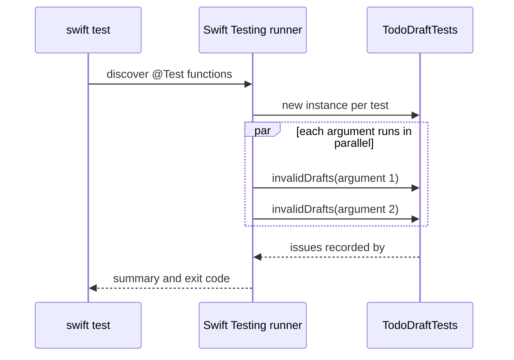

| XCTest | Swift Testing | Notes |
| --- | --- | --- |
| `class FooTests: XCTestCase` | `struct FooTests` (optionally `@Suite`) | A fresh instance per test; use `init` and `deinit` for setup and teardown. |
| `func testSomething()` | `@Test func something()` | Display names: `@Test("Reads like a sentence")`. |
| `XCTAssertEqual(a, b)` | `#expect(a == b)` | The macro captures both sides and prints them on failure. |
| `XCTUnwrap(x)` | `try #require(x)` | Stops the test when `nil`. |
| `XCTAssertThrowsError` | `#expect(throws: MyError.self) { ... }` | Or an `Equatable` error value, as above. |
| Loops inside one test | `@Test(arguments:)` | Each argument is a separate, parallel, individually re-runnable case. |
| `continueAfterFailure` | Not needed | `#expect` always continues, `#require` always stops. |
| Serial by default | Parallel by default | Opt out with the `.serialized` trait. |

```bash
swift test                                   # all tests, parallel
swift test --filter TodoDraftTests           # one suite
swift test --filter "invalidDrafts"          # one test (all its arguments)
swift test --parallel --num-workers 4        # XCTest parallelism
swift test --enable-code-coverage && swift test --show-codecov-path
```

### 2.9 Pitfalls

| Pitfall | Symptom | Fix |
| --- | --- | --- |
| Public type without a public initialiser | `error: 'Todo' initializer is inaccessible due to 'internal' protection level` | Write `public init(...)`; the synthesised memberwise init is always internal. |
| Storing a non-escaping closure | `error: converting non-escaping parameter 'handler' to generic parameter 'Element' may allow it to escape` | Mark the parameter `@escaping`. |
| Relying on `Set` or `Dictionary` order | Tests pass locally, fail in CI; JSON key order changes between runs | Sort before comparing or returning: `.sorted()`, `.sorted(by: \.id)`. |
| Reading a missing dictionary key | Value is `nil`, code later crashes on `!` | Use `d[key, default: 0]` or `?? fallback`. |
| `@testable import` in a release build | `error: module 'TodoCore' was not compiled for testing` | Run tests in debug (`swift test`), or add `-enable-testing` for release tests. |
| Mutating a `let` struct | `error: cannot use mutating member on immutable value: 'frozen' is a 'let' constant` | Declare it with `var`, or return a modified copy like `Todo.completed()`. |
| `sorted` assumed stable | Equal elements come out in a different order after a refactor | Add a tie-breaker key (the starter sorts by priority, then id). |
| Two tests sharing a global | Flaky failures once Swift Testing runs tests in parallel | Create state inside each test (the starter makes a new repository per test) or add `.serialized`. |

### 2.10 Best Practices

- **Name for the call site**: `move(task, to: column)` beats `moveTask(task, column)`; read the call aloud.
- **Prefer key paths and method references**: `map(\.title)` and `filter(matches)` state intent without closure noise.
- **Model states with enums, not optionals**: an enum with payloads removes impossible combinations and forces exhaustive handling.
- **Keep targets small and acyclic**: domain, adapters and entry point as separate modules give faster incremental builds and enforced boundaries.
- **Expose the minimum**: default to `internal`, promote to `package` or `public` only when another module needs it.
- **Commit `Package.resolved`**: reproducible builds and reviewable dependency upgrades.
- **Parameterise tests instead of looping**: each argument fails and re-runs on its own.

### 2.11 Hands-on Exercise

Add a `search` parameter to `GET /todos` that keeps only to-dos whose title contains the text, case-insensitively.

1. In `Sources/TodoCore/TodoQuery.swift`, add `public var search: String?` and extend both initialisers.
2. In `matches(_:)`, add: `if let search, !todo.title.lowercased().contains(search.lowercased()) { return false }`.
3. In `Sources/TodoAPI/Routes.swift`, pass `params.get("search")`.
4. Add a parameterised test in `Tests/TodoCoreTests/TodoQueryTests.swift` with arguments `[("URGENT", [2, 4]), ("done", [3]), ("nothing", [])]`.

Expected: `swift test --filter TodoQueryTests` passes, and `curl -s 'localhost:8080/todos?search=ship'` returns only matching items. Everything you need is in `TodoQuery`; `String.contains(_:)` with a `String` argument is in the standard library since Swift 5.7, so no Foundation import is needed.

[Back to top ⤴️](#-table-of-contents)

---

## 3. Stage 3: Value Semantics, ARC, Protocols, Generics & Errors

This is the stage where Swift stops looking like other languages. You learn how values and references differ in memory, how ARC frees objects and how it leaks them, how protocols and generics replace class hierarchies, when `some` beats `any`, how typed throws changes error handling, and how noncopyable types and exclusivity checks give you Rust-style guarantees. Prerequisites: Stages 1 and 2. Afterwards you can design a domain module like `TodoCore` whose types are cheap to copy, safe to share across threads, and easy to test behind protocols.

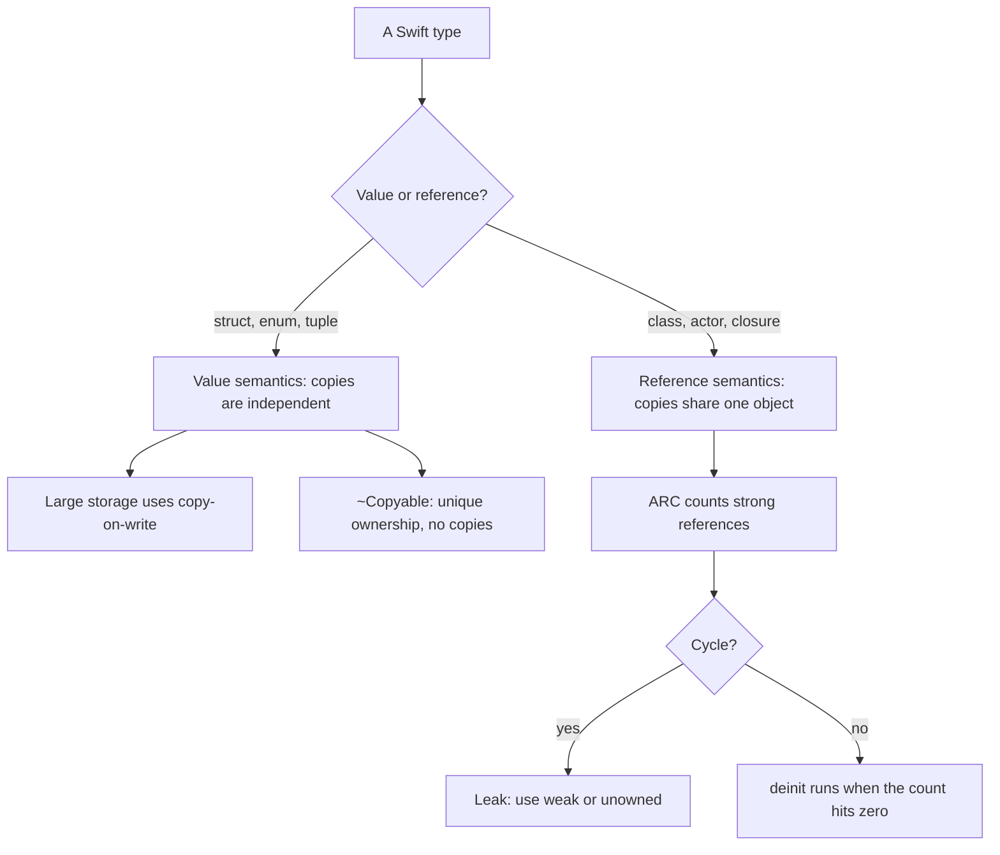

### 3.1 Value Types, Reference Types and Copy-on-Write

A struct or enum is a value: assignment copies it, and a copy never sees later changes to the original. A class instance is a reference: assignment copies the pointer, and every copy sees the same object.

```swift
// values.swift
struct Point { var x = 0, y = 0 }
final class Box { var x = 0 }

var p1 = Point()
var p2 = p1          // independent copy
p2.x = 10
print(p1.x, p2.x)    // 0 10

let b1 = Box()
let b2 = b1          // same object; `let` only freezes the reference
b2.x = 10
print(b1.x, b2.x)    // 10 10
print(b1 === b2)     // true: identity comparison, only for references
```

Copying a value that owns a large buffer (an `Array` with a million elements, a `String`, a `Dictionary`) would be expensive, so the standard library uses **copy-on-write** (COW): the struct holds a reference to heap storage, copies share it, and the first mutation of a shared buffer makes a private copy.

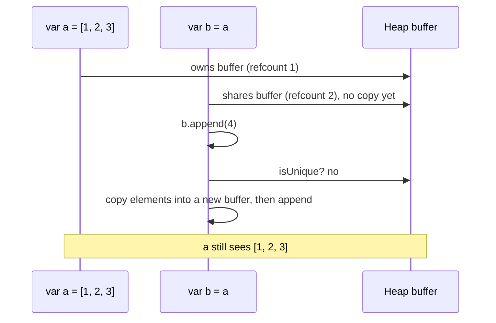

You can give your own types the same behaviour with `isKnownUniquelyReferenced`:

```swift
// cow.swift
final class Storage {
    var items: [Int]
    init(_ items: [Int]) { self.items = items }
}

struct IntBag {
    private var storage = Storage([])

    var items: [Int] { storage.items }

    mutating func insert(_ value: Int) {
        if !isKnownUniquelyReferenced(&storage) {   // shared with another copy?
            storage = Storage(storage.items)        // then copy before writing
            print("copied")
        }
        storage.items.append(value)
    }
}

var bag = IntBag()
bag.insert(1)            // unique: no copy
var other = bag          // shares storage
other.insert(2)          // prints "copied"
print(bag.items, other.items)   // [1] [1, 2]
```

| Choose | When | Example in the starter |
| --- | --- | --- |
| `struct` | Data with no identity; equality means "same contents" | `Todo`, `TodoDraft`, `TodoQuery`, `TodoStats`, `ServerConfig` |
| `enum` | A fixed set of states or choices | `Priority`, `ValidationError` |
| `final class` | Shared identity, a lifetime (`deinit`), or Objective-C interop | None in the domain; Hummingbird uses classes internally |
| `actor` | Shared mutable state accessed from many tasks | `InMemoryTodoRepository` |

The starter's `Todo.completed()` is a small example of thinking in values: it returns a modified copy instead of mutating shared state, and the repository decides whether to store it.

```swift
public func completed() -> Todo {
    var copy = self
    copy.isDone = true
    return copy
}
```

### 3.2 ARC: Strong, Weak and Unowned References

Automatic Reference Counting inserts retain and release calls at compile time. Each class instance has a strong reference count; when it reaches zero, `deinit` runs and the memory is freed immediately. There is no collector and no pause, but there is also no cycle detection: two objects that hold each other strongly are never freed.

```swift
// arc.swift
final class Owner {
    let name: String
    var pet: Pet?
    init(name: String) { self.name = name }
    deinit { print("Owner \(name) freed") }
}

final class Pet {
    weak var owner: Owner?          // weak: does not keep the owner alive; becomes nil when it dies
    unowned let vet: Vet            // unowned: never nil; crashes if used after the vet is freed
    init(vet: Vet) { self.vet = vet }
    deinit { print("Pet freed") }
}

final class Vet { deinit { print("Vet freed") } }

let vet = Vet()
do {
    let ada = Owner(name: "Ada")
    ada.pet = Pet(vet: vet)
    ada.pet?.owner = ada            // weak back-reference, so no cycle
}                                   // prints "Owner Ada freed", then "Pet freed"
```

Closures are reference types and capture strongly by default. An object that stores a closure which captures `self` creates a cycle:

```swift
// closure_cycle.swift
final class Poller {
    var onTick: (() -> Void)?
    var ticks = 0

    func start() {
        // onTick = { self.ticks += 1 }       // cycle: self -> onTick -> self, never freed
        onTick = { [weak self] in            // break it with a weak capture
            guard let self else { return }   // Swift 5.8+ shorthand for rebinding self
            self.ticks += 1
        }
    }
    deinit { print("Poller freed") }
}

do {
    let poller = Poller()
    poller.start()
    poller.onTick?()
    print(poller.ticks)    // 1
}                          // prints "Poller freed" only because of [weak self]
```

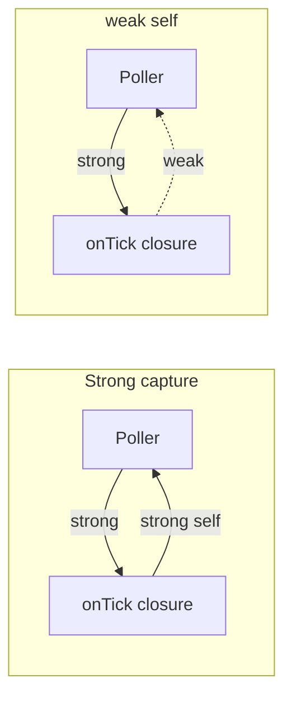

| Reference | Keeps object alive | Type | Use it for | Cost |
| --- | --- | --- | --- | --- |
| strong (default) | Yes | `T` | Ownership | Atomic increment and decrement |
| `weak` | No; becomes `nil` | `T?`, always `var` (or `weak let` since 6.2) | Delegates, parent pointers, closures stored by `self` | Side-table allocation on first weak reference |
| `unowned` | No; traps if used after free | `T` | A child that never outlives its parent | Cheaper than weak |
| `unowned(unsafe)` | No; undefined behaviour after free | `T` | Measured hot paths only | None |

Value types avoid all of this. That is the main reason idiomatic Swift reaches for structs first, and why the starter's domain contains no classes at all.

### 3.3 Protocols, Extensions and Default Implementations

A protocol declares requirements. Any type (struct, enum, class, actor) can conform, and **extensions** can add conformances to types you do not own and default implementations to protocols. This is protocol-oriented design: compose small capabilities instead of inheriting from a base class.

```swift
// protocols.swift
protocol Describable {
    var summary: String { get }
    func badge() -> String            // requirement with a default below
}

extension Describable {
    func badge() -> String { "[\(summary.prefix(3).uppercased())]" }   // default implementation
}

struct Chore: Describable { let title: String; var summary: String { title } }
enum Level: Describable {
    case info, warning
    var summary: String { self == .info ? "information" : "warning" }
    func badge() -> String { self == .warning ? "(!)" : "(i)" }        // custom implementation
}

extension Int: Describable { var summary: String { "number \(self)" } }  // retroactive for your own protocol is fine

let things: [any Describable] = [Chore(title: "ship"), Level.warning, 42]
for thing in things { print(thing.badge(), thing.summary) }
```

The starter defines its storage as a protocol so the HTTP layer never depends on a concrete store:

```swift
public protocol TodoRepository: Sendable {
    func create(_ draft: TodoDraft) async throws(ValidationError) -> Todo
    func all() async -> [Todo]
    func find(id: Int) async -> Todo?
    func markDone(id: Int) async -> Todo?
    func delete(id: Int) async -> Bool
}
```

| Line / API | Role | What happens at runtime |
| :--- | :--- | :--- |
| `protocol TodoRepository: Sendable` | Every conformer must be safe to share between tasks | HTTP handlers are `@Sendable` closures that capture the repository. |
| `async` requirements | Conformers may suspend | An actor's synchronous methods satisfy them, because calling into an actor from outside is already async. |
| `throws(ValidationError)` | Typed throws in a protocol | Callers can `catch` without a type cast; see 3.6. |
| Return `Todo?`, `Bool` | Absence is not an error | "Not found" is ordinary control flow; the route turns it into a 404. |

Protocols with **associated types** describe families of types, like `Sequence` with its `Element`:

```swift
// associated.swift
protocol Store {
    associatedtype Item: Identifiable
    mutating func save(_ item: Item)
    func load(id: Item.ID) -> Item?
}

struct Note: Identifiable { let id: String; var text: String }

struct DictionaryStore<Item: Identifiable>: Store {
    private var items: [Item.ID: Item] = [:]
    mutating func save(_ item: Item) { items[item.id] = item }
    func load(id: Item.ID) -> Item? { items[id] }
}

var notes = DictionaryStore<Note>()
notes.save(Note(id: "a", text: "hi"))
print(notes.load(id: "a")?.text ?? "missing")
```

### 3.4 Generics, Constraints and Key Paths

Generic code is written once and works for any type that meets its constraints. The compiler type-checks the generic body once; the optimiser then usually **specialises** it for each concrete type, so generic code is as fast as hand-written code.

```swift
// generics.swift
func largest<T: Comparable>(_ values: [T]) -> T? {
    guard var best = values.first else { return nil }
    for v in values.dropFirst() where v > best { best = v }
    return best
}
print(largest([3, 9, 2]) ?? 0, largest(["b", "a"]) ?? "")

// where clauses constrain associated types
func allEqual<C: Collection>(_ c: C) -> Bool where C.Element: Equatable {
    guard let first = c.first else { return true }
    return c.allSatisfy { $0 == first }
}
print(allEqual([1, 1, 1]), allEqual("aab"))

// conditional conformance: Pair is Equatable only when its parts are
struct Pair<A, B> { let first: A; let second: B }
extension Pair: Equatable where A: Equatable, B: Equatable {}
print(Pair(first: 1, second: "x") == Pair(first: 1, second: "x"))

// generic extension with a constraint
extension Array where Element: Numeric {
    var total: Element { reduce(0, +) }
}
print([1.5, 2.5].total)
```

The starter adds a generic sort that takes a key path, which reads well and works for any `Comparable` property of any sequence element:

```swift
extension Sequence {
    /// Sorts by any `Comparable` property: `todos.sorted(by: \.id)`.
    public func sorted<Value: Comparable>(by keyPath: KeyPath<Element, Value>) -> [Element] {
        sorted { $0[keyPath: keyPath] < $1[keyPath: keyPath] }
    }
}
```

| Line / API | Role | What happens at runtime |
| :--- | :--- | :--- |
| `extension Sequence` | Adds the method to arrays, sets, dictionary values, ranges | One definition, every sequence. |
| `<Value: Comparable>` | The property type must be orderable | `\.title` (String) and `\.priority` (Priority) both work; `\.tags` (Set) does not compile. |
| `KeyPath<Element, Value>` | A typed reference to a property | `\.id` is checked at compile time; renaming the property updates every use. |
| `$0[keyPath: keyPath]` | Reads the property | After specialisation this is a direct field load. |

### 3.5 `some` versus `any`: Opaque and Existential Types

Both keywords let you talk about "a type that conforms to `P`", but they mean different things and cost different amounts.

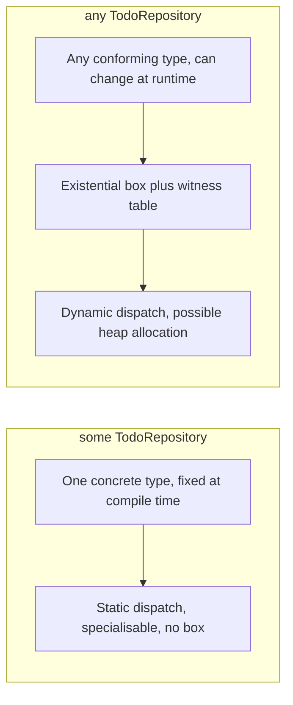

```swift
// some_any.swift
protocol Shape { func area() -> Double }
struct Square: Shape { let side: Double; func area() -> Double { side * side } }
struct Circle: Shape { let r: Double; func area() -> Double { 3.14159 * r * r } }

func totalArea(_ shapes: [any Shape]) -> Double {      // heterogeneous: needs any
    shapes.reduce(0) { $0 + $1.area() }
}

func describe(_ shape: some Shape) -> String {         // one type per call site: some
    "area \(shape.area())"
}

func makeDefault() -> some Shape { Square(side: 2) }   // caller sees "some Shape", not Square

print(totalArea([Square(side: 1), Circle(r: 1)]), describe(Circle(r: 2)), makeDefault().area())
```

| Question | `some P` (opaque) | `any P` (existential) |
| --- | --- | --- |
| How many concrete types? | Exactly one per declaration or call | Any number, even in one array |
| Dispatch | Static; the optimiser can inline | Dynamic through a witness table |
| Storage | The value itself | A box (inline buffer of 3 words, heap beyond that) |
| Associated types and `Self` requirements | Fully usable | Usable since Swift 5.7, but returned associated types are erased to their constraints |
| Typical use | Parameters, return types, `body: some View` | Heterogeneous collections, stored properties that change type |

Default to `some`. The starter's `buildRouter(repository: some TodoRepository)` takes an opaque parameter, so the route closures call the concrete repository with no boxing. The upcoming feature `ExistentialAny` (enable it with `.enableUpcomingFeature("ExistentialAny")`) makes the bare spelling `Shape` illegal for existentials, which forces every boxed use to be written `any Shape` and therefore visible in review.

### 3.6 Error Handling: `throws`, Typed `throws`, `Result` and `defer`

A Swift error is any value conforming to `Error`, usually an enum. Throwing functions are marked `throws`, and every call is marked `try`, so the possible exit points are visible in the source. Errors are not exceptions: there is no stack unwinding cost, a throw is an ordinary return with a flag.

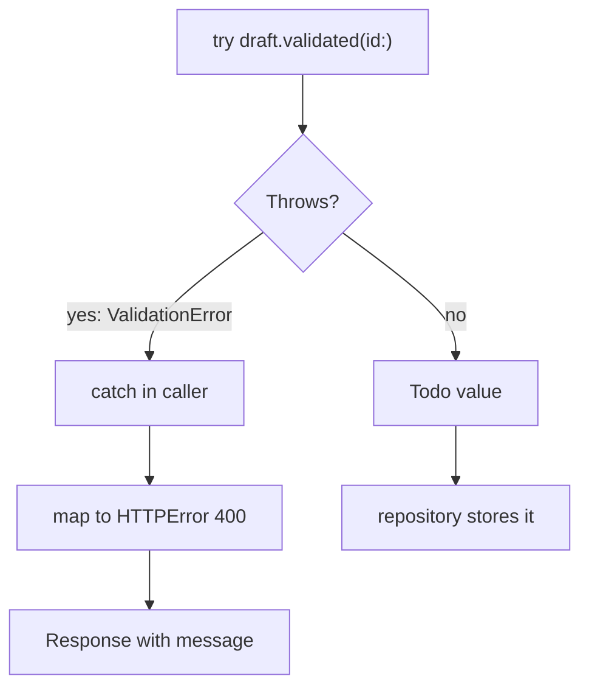

Since Swift 6.0 a function can declare the exact error type it throws (SE-0413). The starter's validation uses it, so callers know every failure case at compile time:

```swift
public func validated(id: Int) throws(ValidationError) -> Todo {
    let title = self.title.trimmed
    guard !title.isEmpty else { throw .emptyTitle }
    guard title.count <= Self.maxTitleLength else {
        throw .titleTooLong(limit: Self.maxTitleLength)
    }

    let tags = (self.tags ?? []).map { $0.trimmed.lowercased() }.filter { !$0.isEmpty }
    guard tags.count <= Self.maxTags else { throw .tooManyTags(limit: Self.maxTags) }
    if let bad = tags.first(where: { !$0.isValidTag }) {
        throw .invalidTag(bad)
    }

    return Todo(id: id, title: title, priority: priority ?? .normal, tags: Set(tags))
}
```

| Line / API | Role | What happens at runtime |
| :--- | :--- | :--- |
| `throws(ValidationError)` | The only error type this can throw | `throw SomeOtherError()` inside is a compile error. |
| `throw .emptyTitle` | Implicit member syntax | The type is known, so the enum name can be omitted. |
| `guard ... else { throw ... }` | Validation as early exits | Each rule is one line and fails fast. |
| Return value | The validated `Todo` | Callers get either a valid value or a typed error, never a half-valid object. |

And the route catches it without any casting. A plain `do` block still types its `catch` as `any Error` in Swift 6.3 (inferring the thrown type of `do` bodies is behind the `FullTypedThrows` upcoming feature), so the starter states the type with `do throws(ValidationError)`:

```swift
// `do throws(ValidationError)` states the thrown type, so in the catch
// block `error` is a ValidationError, not `any Error`.
do throws(ValidationError) {
    let todo = try await repository.create(draft)
    return EditedResponse(status: .created, response: TodoBody(todo: todo))
} catch {
    throw HTTPError(.badRequest, message: error.description)
}
```

With a plain `do` instead, the compiler reports `value of type 'any Error' has no member 'description'` on the `catch` line.

The other error tools:

```swift
// errors.swift
enum ParseError: Error { case empty, notANumber(String) }

func parsePort(_ s: String) throws(ParseError) -> Int {
    guard !s.isEmpty else { throw .empty }
    guard let n = Int(s) else { throw .notANumber(s) }
    return n
}

// try? turns any error into nil; try! traps on error
let maybe = try? parsePort("x")          // nil
let sure = try! parsePort("8080")        // 8080, crashes if it ever throws

// Result stores success or failure as a value, e.g. to pass across a callback
let result = Result { () throws(ParseError) -> Int in try parsePort("") }
switch result {
case .success(let port): print(port)
case .failure(.empty): print("empty input")
case .failure(.notANumber(let raw)): print("bad", raw)
}

// rethrows: throws only if the closure argument throws
func retry<T>(_ times: Int, _ body: () throws -> T) rethrows -> T {
    for _ in 1..<times { if let v = try? body() { return v } }
    return try body()
}
print(retry(3) { 1 })                    // no try needed: closure does not throw

// defer runs when the scope exits, by any path
func withLog() throws(ParseError) -> Int {
    print("start")
    defer { print("end") }               // runs after the return value is computed, or on throw
    return try parsePort("443")
}
print(maybe as Any, sure, try withLog())
```

| Tool | Use when |
| --- | --- |
| `throws(SpecificError)` | A module's internal API with a closed, stable set of failures (validation, parsing). |
| `throws` (untyped, `any Error`) | Public APIs that may add failure kinds later, or that pass through errors from dependencies. |
| `Result<T, E>` | Storing an outcome, or bridging callback APIs. Less needed now that `async throws` exists. |
| Optional return | Absence is normal (`find(id:)`), not a failure. |
| `fatalError`, `precondition` | Programmer errors that must never happen in correct code. |

Typed throws is not a default to reach for everywhere. Changing a public typed error later is a source-breaking change, so the Swift team recommends untyped `throws` for most public APIs and typed throws for internal code, embedded targets (no existential allocation) and generic code that forwards its closure's error type.

### 3.7 Noncopyable Types and Ownership

Since Swift 5.9 a struct or enum can opt out of copying with `~Copyable`. Each value then has exactly one owner, the compiler tracks moves, and `deinit` is allowed on structs. This models resources such as file descriptors, locks and one-shot tokens without classes or ARC. Swift 6.0 extended it to generics (`<T: ~Copyable>`) and to `Optional`.

```swift
// noncopyable.swift
struct FileHandle: ~Copyable {
    private let fd: Int32
    init(fd: Int32) { self.fd = fd; print("open \(fd)") }

    borrowing func read() -> String { "data from \(fd)" }   // borrow: look, do not take

    consuming func close() {                                 // consume: the caller gives it up
        print("close \(fd)")
        discard self                                          // skip deinit, we closed manually
    }

    deinit { print("deinit closes \(fd)") }                  // runs if close() was never called
}

func useFile() {
    let file = FileHandle(fd: 3)
    print(file.read())
    file.close()
    // file.read()     // error: 'file' used after consume
}
useFile()

do {
    let leaked = FileHandle(fd: 4)
    _ = leaked.read()
}                       // prints "deinit closes 4": cleanup is deterministic
```

| Parameter convention | Meaning | Caller can use the value afterwards? |
| --- | --- | --- |
| `borrowing` | Read-only access for the call | Yes |
| `inout` | Exclusive mutable access for the call | Yes |
| `consuming` | Ownership moves into the callee | No |
| `consume x` (operator) | End the lifetime of a local explicitly | No |

`Mutex` and `Atomic` in the `Synchronization` module are noncopyable for exactly this reason: copying a lock would make two locks.

### 3.8 Memory Safety: Exclusivity, Unsafe Pointers and Strict Mode

Swift is memory-safe by default: array indices are bounds-checked, integers trap on overflow, variables must be initialised before use, and the **law of exclusivity** forbids overlapping accesses to the same variable when at least one is a write. The compiler enforces exclusivity statically where it can and inserts runtime checks for class properties, globals and escaping closures.

```swift
// exclusivity.swift
var stepSize = 1

func increment(_ number: inout Int) {
    number += stepSize               // reads the global while `number` may alias it
}

var count = 1
increment(&count)                    // fine: different variables
print(count)                         // 2
// increment(&stepSize)              // runtime trap: "Simultaneous accesses to 0x..., but modification requires exclusive access"

var pair = (a: 1, b: 2)
swap(&pair.a, &pair.b)               // fine: the compiler proves the tuple elements do not overlap
print(pair)
```

When you need raw memory (C interop, binary parsing, performance-critical buffers), the `Unsafe*` family is available. Everything with "unsafe" in the name skips checks, so keep it inside small, well-tested functions:

```swift
// unsafe.swift
let bytes: [UInt8] = [0x01, 0x00, 0x00, 0x00]
let value = bytes.withUnsafeBytes { raw in
    raw.loadUnaligned(as: UInt32.self)      // little-endian platforms: 1
}
print(value)

var numbers = [1, 2, 3]
numbers.withUnsafeMutableBufferPointer { buffer in
    for i in buffer.indices { buffer[i] *= 10 }   // no bounds checks inside the closure's hot loop
}
print(numbers)                               // [10, 20, 30]
// Never let the pointer escape the closure: the array may move or be freed afterwards.
```

Swift 6.2 added an opt-in **strict memory safety** mode (SE-0458, `-strict-memory-safety` or `.strictMemorySafety()` in SwiftPM). It warns on every use of an unsafe construct unless the expression is marked with the `unsafe` keyword, which makes unsafe code searchable and reviewable, similar to `unsafe` blocks in Rust. Swift 6.2 also added `Span` and `MutableSpan`, safe non-escaping views over contiguous memory that replace many pointer uses; Masterclass M3 covers them.

### 3.9 Pitfalls

| Pitfall | Symptom | Fix |
| --- | --- | --- |
| Closure stored on `self` captures `self` strongly | `deinit` never runs; memory grows; Xcode memory graph shows a cycle | `[weak self]` plus `guard let self`, or restructure so the closure does not need `self`. |
| `unowned` reference outlives its target | `Fatal error: Attempted to read an unowned reference but object 0x... was already deallocated` | Use `weak` unless the lifetime relationship is guaranteed. |
| Mutating a struct copy and expecting the original to change | "Saved" value is unchanged (classic with `for var item in items`) | Mutate through the index (`items[i].isDone = true`) or write back the copy. |
| Bare protocol name as a type in a hot loop | Slow code; profiles show `swift_allocObject` and witness-table calls | Use `some P` or a generic parameter; reserve `any P` for heterogeneous storage. |
| Protocol with `Self` or associated type used as a value | `error: use of protocol 'Store' as a type must be written 'any Store'` | Write `any Store`, or better, make the function generic. |
| Expecting a plain `do` block to infer a typed `catch` | `error: value of type 'any Error' has no member 'description'` | Write `do throws(MyError) { ... }`, or enable the `FullTypedThrows` upcoming feature. |
| Public API with typed throws grows a new error case | Clients' exhaustive `catch` blocks stop compiling | Use untyped `throws` on public, evolving APIs. |
| Overlapping `inout` access | `Simultaneous accesses to 0x..., but modification requires exclusive access` | Copy the value into a local first, or pass separate variables. |
| Using a noncopyable value after `consume` | `error: 'file' used after consume` | Restructure ownership, or make the method `borrowing`. |
| Escaping an unsafe pointer from `withUnsafe...` | Random crashes or corrupted data in release builds | Do all pointer work inside the closure; copy results out as values. |

### 3.10 Best Practices

- **Start with a struct**: switch to a class only for identity, shared lifetime or interop, and mark classes `final` unless you designed them for subclassing.
- **Make value types `Sendable` and `Hashable` up front**: it costs nothing for plain data and unblocks concurrency, sets and diffing later.
- **Put abstractions at module boundaries**: a protocol like `TodoRepository` is worth it where you need a second implementation (tests, a database); inside a module, concrete types are simpler.
- **Prefer `some` and generics to `any`**: you keep static dispatch and specialisation; enable `ExistentialAny` so boxed uses are visible.
- **Use typed throws for closed sets of internal failures**: validation and parsing benefit; public evolving APIs should stay untyped.
- **Handle absence with optionals and failure with errors**: "not found" is not an exception.
- **Keep unsafe code tiny and fenced**: wrap pointer work in one function with tests, and turn on strict memory safety in modules that use it.

### 3.11 Hands-on Exercise

Make the storage pluggable by adding a second repository and proving both behave the same.

1. In `Sources/TodoCore/`, create `RecordingTodoRepository.swift`: an `actor` that wraps any `TodoRepository` (store it as `let base: any TodoRepository`) and appends a string like `"create 1"` or `"delete 1"` to a `private(set) var log: [String]` on every mutating call before forwarding it.
2. Write a generic test helper in `Tests/TodoCoreTests/RepositoryTests.swift`: `func exerciseRepository(_ repo: some TodoRepository) async throws` that runs create, mark-done and delete and checks the results.
3. Call it with `InMemoryTodoRepository()` and with `RecordingTodoRepository(base: InMemoryTodoRepository())`, then `#expect(await recorder.log == ["create 1", "done 1", "delete 1"])`.

Expected: all tests pass under `swift test` with `-Xswiftc -warnings-as-errors` (the CI setting), which proves your wrapper is `Sendable`-correct in Swift 6 mode. The repository protocol and the in-memory actor you are wrapping are in `Sources/TodoCore/TodoRepository.swift`.

[Back to top ⤴️](#-table-of-contents)

---

## 4. Stage 4: Structured Concurrency, Actors & Sendable

Swift's concurrency model is built into the language: `async` functions, tasks arranged in a tree, actors that serialise access to state, and `Sendable` checking that turns data races into compile errors in Swift 6 mode. Prerequisite: Stage 3, especially value semantics. Afterwards you can explain every concurrency annotation in the starter and write concurrent code the compiler proves race-free.

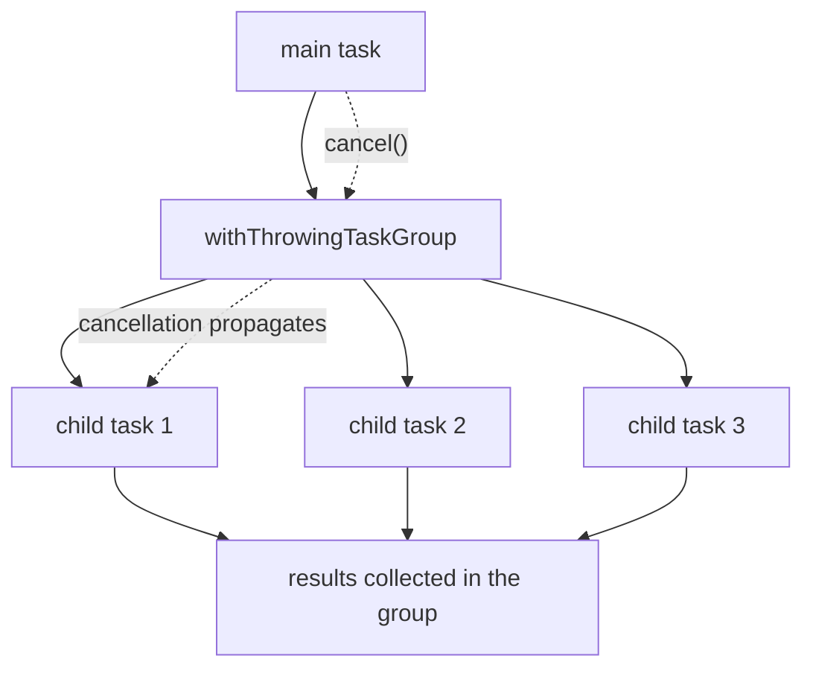

### 4.1 `async`/`await` and Suspension Points

An `async` function can suspend at each `await`, giving its thread back to the cooperative pool while it waits. Nothing else changes: locals, loops and `try` work as in synchronous code.

```swift
// async_basics.swift
func fetchTitle(id: Int) async throws -> String {
    try await Task.sleep(for: .milliseconds(50))   // suspends; the thread runs other work
    return "todo \(id)"
}

@main
struct Demo {
    static func main() async throws {
        let first = try await fetchTitle(id: 1)                 // sequential
        async let second = fetchTitle(id: 2)                    // starts now, runs concurrently
        async let third = fetchTitle(id: 3)
        let rest = try await [second, third]                    // wait for both
        print(first, rest)
    }
}
```

### 4.2 Task Groups and Cancellation

A task group runs a dynamic number of children and guarantees they all finish before the group returns. The starter's tests use one to hammer the repository with 100 concurrent creates:

```swift
@Test("Concurrent creates never reuse an id")
func concurrentCreates() async throws {
    let repo = InMemoryTodoRepository()
    try await withThrowingTaskGroup(of: Todo.self) { group in
        for n in 1...100 {
            group.addTask { try await repo.create(TodoDraft(title: "task \(n)")) }
        }
        var ids = Set<Int>()
        for try await todo in group { ids.insert(todo.id) }
        #expect(ids == Set(1...100))
    }
}
```

Cancellation is cooperative: cancelling a task sets a flag, and code checks it with `try Task.checkCancellation()` or `Task.isCancelled`. `Task.sleep` and most library async calls throw `CancellationError` when cancelled.

### 4.3 Actors and Reentrancy

An actor is a reference type whose mutable state is only touched by one task at a time. Calls from outside are `async` because they may wait for the actor to be free. The starter's repository is an actor:

```swift
public actor InMemoryTodoRepository: TodoRepository {
    private var items: [Int: Todo] = [:]
    private var nextID = 1

    public func create(_ draft: TodoDraft) throws(ValidationError) -> Todo {
        let todo = try draft.validated(id: nextID)
        items[todo.id] = todo
        nextID += 1
        return todo
    }
}
```

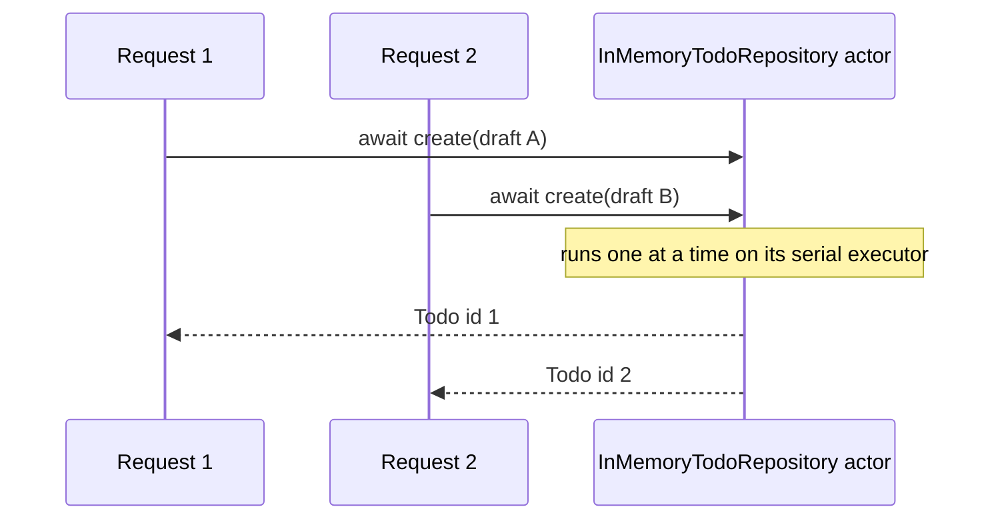

`create` has no `await` inside, so it runs to completion without interleaving and the id counter is safe. If an actor method awaits in the middle, other calls can run at that suspension point (reentrancy), so state read before the `await` may be stale afterwards. Re-check invariants after every `await` inside an actor.

### 4.4 `Sendable`, `@MainActor` and Swift 6 Mode

`Sendable` marks types that are safe to pass between concurrency domains: value types made of `Sendable` parts, actors, immutable `final class`es, and types protected by a lock (`@unchecked Sendable`, used sparingly). In Swift 6 mode, passing a non-`Sendable` value across an isolation boundary is an error. `@MainActor` isolates UI code to the main thread. Swift 6.2 lets a module make `@MainActor` the default (`.defaultIsolation(MainActor.self)`), and `@concurrent` marks functions that should run off the caller's actor. Masterclass M1 goes deep on both.

### 4.5 Pitfalls

| Pitfall | Symptom | Fix |
| --- | --- | --- |
| Capturing a non-`Sendable` class in `Task {}` | `error: passing closure as a 'sending' parameter risks causing data races` | Make the type `Sendable` (struct or actor), or keep the work on one actor. |
| Global mutable `var` | `error: var 'cache' is not concurrency-safe because it is nonisolated global shared mutable state` | `let`, an actor, `@MainActor`, or a `Mutex`. |
| Assuming no interleaving across `await` in an actor | Duplicate work or lost updates under load | Re-read state after `await`; move the check and the write into one synchronous method. |
| Blocking a cooperative thread (`sleep`, semaphores) | Throughput collapses; deadlocks with few cores | Use `try await Task.sleep(for:)` and async APIs; never wait on a semaphore in async code. |

### 4.6 Best Practices

- **Prefer structured concurrency**: `async let` and task groups bound lifetimes and propagate cancellation; unstructured `Task {}` needs a reason.
- **Keep actor methods synchronous inside**: no `await` between reading and writing state means no reentrancy surprises.
- **Make data `Sendable` value types**: they cross isolation boundaries for free.

[Back to top ⤴️](#-table-of-contents)

---

## 5. Stage 5: I/O, Networking, Server-side Swift & Testing

Stage 5 connects Swift to the outside world: JSON with `Codable`, HTTP clients, SwiftNIO's event loops, and building and testing an HTTP API with Hummingbird, which is exactly what `Sources/TodoAPI` does. Prerequisite: Stage 4. Afterwards you can build a JSON service and test it in memory without opening a socket.

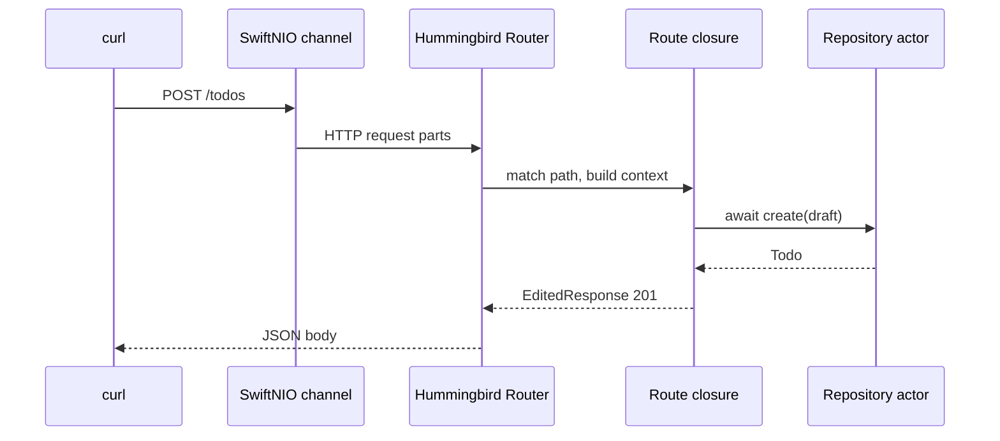

### 5.1 `Codable` and JSON

```swift
// codable.swift
import Foundation

struct TodoDTO: Codable {
    let id: Int
    let title: String
    let isDone: Bool

    enum CodingKeys: String, CodingKey {   // map Swift names to wire names
        case id, title
        case isDone = "is_done"
    }
}

let json = #"{"id": 1, "title": "Ship", "is_done": false}"#
let todo = try JSONDecoder().decode(TodoDTO.self, from: Data(json.utf8))
let encoder = JSONEncoder()
encoder.outputFormatting = [.sortedKeys, .prettyPrinted]
print(String(decoding: try encoder.encode(todo), as: UTF8.self))
```

### 5.2 Routing and Request Handling in Hummingbird

```swift
router.get("/todos/:id") { _, context -> TodoBody in
    let id = try context.parameters.require("id", as: Int.self)
    guard let todo = await repository.find(id: id) else {
        throw HTTPError(.notFound, message: "no todo with id \(id)")
    }
    return TodoBody(todo: todo)
}
```

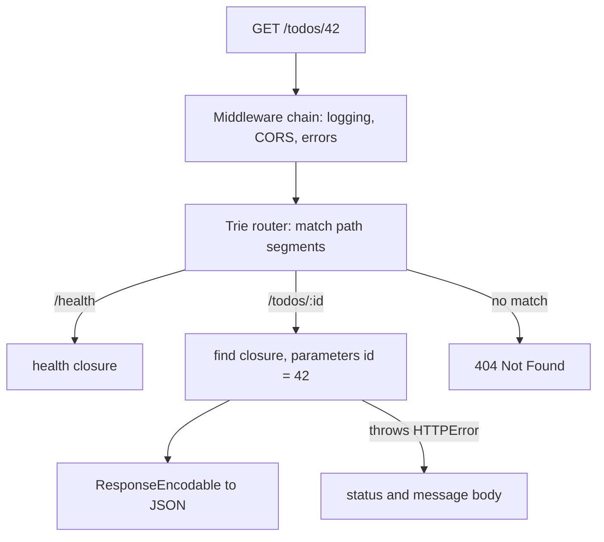

`context.parameters.require("id", as: Int.self)` throws a 400 error when the segment is not an integer, which the starter's `nonNumericIDIsBadRequest` test checks. Returning a type that conforms to `ResponseEncodable` encodes it as JSON.

### 5.3 Testing an HTTP API in Memory

```swift
@Test func health() async throws {
    try await makeApp().test(.router) { client in
        try await client.execute(uri: "/health", method: .get) { response in
            #expect(response.status == .ok)
            #expect(String(buffer: response.body) == "ok")
        }
    }
}
```

`.test(.router)` sends requests straight into the router with no network, so the tests are fast and do not need a free port. `.test(.live)` starts a real server on an ephemeral port when you need to test middleware that depends on the socket.

### 5.4 Pitfalls

| Pitfall | Symptom | Fix |
| --- | --- | --- |
| Binding to `localhost` in a container | Container starts, but `curl` from the host gets "connection reset" | Bind `0.0.0.0` (the starter reads `HOST`, default `0.0.0.0`). |
| Doing blocking file I/O on an event loop | Latency spikes for every request on that loop | Use `NIOFileSystem` or move the work off the loop. |
| Decoding errors returned as 500 | Clients cannot tell bad input from a server bug | Map `DecodingError` and validation errors to 400 with a message. |

### 5.5 Best Practices

- **Keep handlers thin**: parse, call the domain, map the result; business rules live in `TodoCore`.
- **Inject dependencies into the router builder**: `buildRouter(repository:)` makes every route testable.
- **Test through the router, not the socket**: in-memory tests are fast and deterministic.

[Back to top ⤴️](#-table-of-contents)

---

## 6. Stage 6: Performance, Security, Packaging & Deployment

Stage 6 covers what happens after the code works: optimisation settings, measuring before tuning, the main sources of overhead in Swift (ARC traffic, existentials, unspecialised generics), and packaging a small, non-root container. Prerequisite: Stage 5. Afterwards you can read this repo's `Dockerfile` line by line and profile a hot path.


### 6.1 Build Configurations

```bash
swift build -c release                              # -O, whole-module optimisation
swift build -c release -Xswiftc -Osize              # smaller binary, slightly slower
swift build -c release --static-swift-stdlib        # no Swift runtime needed on the host
swift build -c release -Xswiftc -enforce-exclusivity=checked   # keep runtime exclusivity checks (default)
```

### 6.2 The Container Build

The repo's `Dockerfile` resolves dependencies in their own layer, builds a release binary with the Swift runtime linked statically, and copies only that binary into `ubuntu:noble`, where it runs as an unprivileged user on port 8080. The image does not contain the compiler, so it is a fraction of the size of the `swift:6.3-noble` build image.

```mermaid
flowchart TD
    subgraph Build["swift:6.3-noble"]
        M["COPY Package.swift Package.resolved"] --> RES["swift package resolve (cached layer)"]
        RES --> S["COPY Sources Tests"]
        S --> REL["swift build -c release --static-swift-stdlib"]
    end
    subgraph Runtime["ubuntu:noble"]
        CA["ca-certificates, tzdata"] --> U["useradd app"]
        U --> BIN["/usr/local/bin/todo-server"]
    end
    REL --> BIN
```

### 6.3 Pitfalls

| Pitfall | Symptom | Fix |
| --- | --- | --- |
| Benchmarking a debug build | Code is 10-100 times slower than in production | Always measure `-c release`. |
| Copying sources before `Package.resolved` | Every source edit re-fetches all dependencies | Copy the manifest and lockfile first, resolve, then copy sources. |
| Missing `ca-certificates` in the runtime image | Outbound HTTPS fails with certificate errors | Install it in the runtime stage. |

### 6.4 Best Practices

- **Measure first**: Instruments on macOS, `perf` on Linux; optimise the hot path you can see.
- **Ship release builds with a static Swift runtime**: smaller images and no runtime version drift.
- **Run as non-root**: the runtime stage creates and switches to `app` (uid 10001).

[Back to top ⤴️](#-table-of-contents)

---

## M1. Masterclass: Swift 6 Data-Race Safety & Approachable Concurrency

### M1.1 How Isolation Checking Works

Every function and closure in Swift 6 has an isolation: an actor instance, a global actor such as `@MainActor`, or `nonisolated`. When a value crosses from one isolation domain to another, the compiler checks that it is `Sendable`, or, with region-based isolation (SE-0414), that the sender gives up all access to it (`sending`).

```mermaid
flowchart TD
    V["value crosses an isolation boundary"] --> S{"Sendable?"}
    S -->|yes| OK["allowed"]
    S -->|no| REG{"in a disconnected region?"}
    REG -->|"yes, and never used again by the sender"| OK
    REG -->|no| ERR["error: sending value risks causing data races"]
```

### M1.2 Swift 6.2 Approachable Concurrency

```swift
// Package.swift (tools 6.2) for an app or UI module
.target(
    name: "AppUI",
    swiftSettings: [
        .defaultIsolation(MainActor.self),                     // SE-0466: everything is @MainActor unless marked
        .enableUpcomingFeature("NonisolatedNonsendingByDefault"), // SE-0461: async functions stay on the caller's actor
        .enableUpcomingFeature("InferIsolatedConformances"),
    ]
)
```

```swift
// With NonisolatedNonsendingByDefault, CPU-heavy work must opt into running in parallel.
@concurrent
func resize(_ image: [UInt8]) async -> [UInt8] {
    image.map { $0 / 2 }      // runs on the global concurrent executor, off the main actor
}
```

### M1.3 Trade-offs

| Approach | Good for | Cost |
| --- | --- | --- |
| Default `MainActor` isolation | Apps and UI modules, scripts | Background work must be marked `@concurrent` or `nonisolated`. |
| `nonisolated` default (Swift 6.0 behaviour) | Libraries and servers | More `Sendable` annotations. |
| `@unchecked Sendable` with a `Mutex` | Wrapping legacy reference types | You own the correctness proof. |

### M1.4 Production Checklist

- [ ] Every target compiles in Swift 6 mode with `-warnings-as-errors`.
- [ ] No `@unchecked Sendable` without a comment naming the lock that protects it.
- [ ] Library modules keep `nonisolated` defaults; app modules opt into `MainActor` default isolation deliberately.

[Back to top ⤴️](#-table-of-contents)

---

## M2. Masterclass: Macros with SwiftSyntax

### M2.1 How Macro Expansion Works

```mermaid
sequenceDiagram
    participant C as swiftc
    participant P as Macro plugin process
    participant S as SwiftSyntax
    C->>P: syntax tree of the macro use
    P->>S: build new syntax nodes
    S-->>P: expanded code
    P-->>C: source to splice in
    C->>C: type-check the expansion like hand-written code
```

Macros run in a sandboxed plugin process at compile time. They see only syntax, never types, and their output is type-checked like any other code, so a macro cannot do anything you could not write by hand.

### M2.2 Worked Example: Using `#expect` as a Macro

`#expect(a == b)` from Swift Testing is a freestanding expression macro: it expands into code that evaluates both sides once, records them, and reports both values on failure. Writing your own macro needs a `.macro` target and a SwiftSyntax dependency; the full build is part of a later revision of this masterclass.

### M2.3 Trade-offs

| Tool | Runs | Sees types | Cost |
| --- | --- | --- | --- |
| Macro | Compile time, plugin | No | Build time, SwiftSyntax dependency (prebuilt since 6.3 for macro libraries) |
| Generic function | Compile and run time | Yes | None |
| Code generation script | Before build | No | Extra build step and checked-in output |

### M2.4 Production Checklist

- [ ] The macro has expansion tests (`assertMacroExpansion`).
- [ ] The macro emits diagnostics instead of crashing on unexpected syntax.

[Back to top ⤴️](#-table-of-contents)

---

## M3. Masterclass: Ownership, Noncopyable Types, `Span` and `InlineArray`

### M3.1 How Ownership Is Represented

```mermaid
flowchart LR
    OWN["owned value"] -->|"borrowing"| B["read-only access, caller keeps ownership"]
    OWN -->|"inout"| I["exclusive mutable access"]
    OWN -->|"consuming"| C["ownership moves, caller loses it"]
    C --> D["deinit or discard"]
```

### M3.2 Worked Example

```swift
// span.swift (Swift 6.2+)
func checksum(_ bytes: Span<UInt8>) -> UInt32 {
    var sum: UInt32 = 0
    for i in bytes.indices { sum &+= UInt32(bytes[i]) }   // bounds-checked, cannot escape
    return sum
}

let data: [UInt8] = [1, 2, 3, 250]
print(checksum(data.span))                // Array exposes .span in 6.2

var ring: InlineArray<4, Int> = [0, 0, 0, 0]   // fixed size, stored inline, no heap
ring[2] = 7
print(ring[2], ring.count)
```

### M3.3 Trade-offs

| Type | Heap allocation | Size known at compile time | Can escape |
| --- | --- | --- | --- |
| `Array` | Yes | No | Yes |
| `InlineArray<N, T>` | No | Yes | Yes |
| `Span<T>` | No (a view) | No | No |
| `UnsafeBufferPointer<T>` | No (a view) | No | Yes, unsafely |

### M3.4 Production Checklist

- [ ] Pointer-based helpers are replaced with `Span` where the deployment target allows it.
- [ ] Noncopyable resource types have a `deinit` that releases the resource.

[Back to top ⤴️](#-table-of-contents)

---

## M4. Masterclass: C and C++ Interoperability

### M4.1 How the Clang Importer Works

```mermaid
flowchart LR
    H["C or C++ header"] --> MM["module.modulemap"]
    MM --> CI["Clang importer inside swiftc"]
    CI --> SW["Swift declarations"]
    SWS["Swift @c functions"] --> GH["generated C header"]
```

### M4.2 Worked Example

```swift
// Exporting a Swift function to C (Swift 6.3)
@c(todo_version)
public func todoVersion() -> Int32 { 1 }
// The generated header declares: int todo_version(void);
```

### M4.3 Trade-offs

| Direction | Mechanism | Notes |
| --- | --- | --- |
| Swift calls C | Clang module map, `import CLib` | Pointers arrive as `Unsafe*Pointer`. |
| Swift calls C++ | `.interoperabilityMode(.Cxx)` | Supports most value types and templates instantiated in headers. |
| C calls Swift | `@c` (6.3), previously `@_cdecl` | Only C-representable types. |

### M4.4 Production Checklist

- [ ] Every unsafe pointer from C is wrapped in a safe Swift API at the module boundary.
- [ ] Interop modules build with strict memory safety enabled.

[Back to top ⤴️](#-table-of-contents)

---

## M5. Masterclass: Flagship Blueprint: A Production Todo Service

### M5.1 Architecture

```mermaid
flowchart LR
    Client --> LB["Load balancer"]
    LB --> S1["todo-server container"]
    S1 --> API["TodoAPI routes"]
    API --> CORE["TodoCore domain"]
    CORE --> REPO["TodoRepository protocol"]
    REPO --> MEM["InMemoryTodoRepository (tests)"]
    REPO --> PG["PostgresTodoRepository (production)"]
    S1 --> LOG["swift-log and swift-metrics"]
```

### M5.2 Worked Example

The starter in this repo is the first slice of the blueprint: domain, routes, configuration, tests, CI and a container. The production version adds a PostgresNIO-backed repository behind the same protocol, structured logging, metrics and graceful shutdown through `swift-service-lifecycle`.

### M5.3 Trade-offs

| Choice | Option A | Option B |
| --- | --- | --- |
| Framework | Hummingbird: small, modular | Vapor: batteries included (Fluent ORM, Leaf templates) |
| Storage | PostgresNIO directly | An ORM such as Fluent |

### M5.4 Production Checklist

- [ ] `/health` stays cheap and does not touch the database.
- [ ] The container runs as non-root and listens on `PORT`.
- [ ] CI runs format, tests with warnings as errors, a release build and a container smoke test.

[Back to top ⤴️](#-table-of-contents)

---

## 7. Stage 7: Staff Swift Engineer Interview Handbook & Cheatsheet

### 7.1 Core Concepts (Q1-Q10)

#### Q1. What is the difference between a struct and a class in Swift, and how do you choose?

A struct is a value type: assignment and argument passing copy it, two copies never affect each other, and it needs no reference counting unless it contains references. A class is a reference type: copies share one heap object with an identity (`===`), a lifetime managed by ARC, inheritance, and `deinit`.

Choose a struct for data whose identity does not matter, which covers most models, configuration and results. Choose a class when identity or shared lifetime is the point (a connection, a cache shared by several owners), when you need inheritance, or for Objective-C interop. Choose an actor when the shared mutable state is accessed concurrently. In the starter, every domain type is a struct or enum and the only shared mutable state lives in an actor.

#### Q2. How does copy-on-write work, and is it automatic for my own structs?

Copy-on-write is an implementation technique, not a language feature. `Array`, `String`, `Dictionary` and `Set` hold their elements in a heap buffer; copying the struct copies only the pointer and increments a reference count. Before a mutation, the type calls `isKnownUniquelyReferenced` on its buffer; if another copy shares it, it duplicates the buffer first.

Your own struct gets COW behaviour for free only through its stored collections. A struct with ten `Int` fields is simply copied, which is cheap. If you build a struct around your own class-backed storage, you must write the uniqueness check yourself, as in section 3.1, or every copy will share and mutate the same object.

#### Q3. What are optionals, and why are they safer than null references?

`T?` is shorthand for `Optional<T>`, an enum with `.some(T)` and `.none`. Because `T` and `T?` are different types, you cannot call a method of `T` on a `T?` without unwrapping it, so the compiler forces every possible-`nil` path to be handled. Null references in languages without this distinction fail at runtime, far from where the value went missing.

The tools are `if let`/`guard let` binding, `??` defaults, optional chaining with `?.`, `map`/`flatMap`, and pattern matching. Force unwrapping with `!` is an assertion that traps on `nil`, so it belongs only where `nil` would be a programmer error.

#### Q4. Explain `weak` versus `unowned`.

Both are non-owning references that do not increase the strong count, so they break retain cycles. A `weak` reference is always optional and becomes `nil` automatically when the object is freed; reading it is safe. An `unowned` reference is non-optional and assumes the object outlives it; reading it after the object is freed traps.

Use `weak` for delegates, parent pointers and `[weak self]` in stored closures, where the lifetimes are independent. Use `unowned` only when the referenced object provably outlives the reference, such as a child that cannot exist without its parent. When unsure, `weak` is the safe default.

#### Q5. What is the difference between `some` and `any`?

`some P` is an opaque type: one specific concrete type that the compiler knows but hides from the caller. Calls are statically dispatched and the generic code can be specialised. `any P` is an existential: a box that can hold any conforming type, possibly a different one each time, with dynamic dispatch through a witness table and a heap allocation when the value is larger than three words.

Use `some` for parameters and return types by default (`func handle(_ repo: some TodoRepository)`), and `any` when you genuinely need heterogeneity, like `[any Shape]`. The `ExistentialAny` upcoming feature makes the plain protocol name illegal as a type, so every existential is spelled `any` and visible in review.

#### Q6. What does typed throws add, and when should you avoid it?

`throws(E)` (Swift 6.0) declares the exact error type. Callers' `catch` blocks receive `E` instead of `any Error`, so they can switch over cases exhaustively without casting, and no existential box is allocated, which matters in Embedded Swift. Generic functions can forward the error type of a closure with `throws(E)` instead of `rethrows`.

Avoid it on public APIs whose failure modes may grow: adding a case or changing the error type is source-breaking for every caller. The starter uses it for `TodoDraft.validated(id:)`, a closed set of validation rules inside the package, and the HTTP layer maps it to a 400.

#### Q7. How do protocols with associated types differ from generics?

A generic type or function is parameterised by the caller: `Array<Int>`. A protocol's associated type is chosen by the conforming type: `Sequence.Element` is decided by whatever type implements `Sequence`. Associated types let a protocol describe a family of related types (a collection and its index, a store and its item) without fixing them.

Using such a protocol as a value needs `any P` (with erased associated types) or, more efficiently, a generic constraint or `some P`. Primary associated types (`some Sequence<Todo>`) let you constrain the associated type at the use site, which is how `TodoQuery.apply(to:)` accepts any sequence of `Todo`.

#### Q8. What is `Sendable`, and how does the compiler decide a type conforms?

`Sendable` marks types whose values can be safely shared across concurrency domains. Structs and enums are implicitly `Sendable` when all their stored properties are and the type is not public; public types must declare it. Actors are always `Sendable`. A `final class` with only immutable `Sendable` properties can conform. Other classes need `@unchecked Sendable` and their own synchronisation.

In Swift 6 mode, the compiler rejects passing a non-`Sendable` value across an isolation boundary unless region analysis proves the sender never touches it again. That is how data races become compile-time errors rather than intermittent crashes.

#### Q9. How does access control work, and what does `package` add?

There are six levels: `open` (subclass and override from other modules), `public` (use from other modules), `package` (any module in the same SwiftPM package, since 5.9), `internal` (default, this module), `fileprivate` (this file), and `private` (this declaration and its same-file extensions). Synthesised memberwise initialisers are internal, which is why public structs need explicit public initialisers.

`package` solves a real large-codebase problem: shared helpers between your own targets used to require `public`, leaking them to every client. Combined with access-level imports (`internal import Hummingbird`), you can keep dependencies and helpers out of a module's public surface.

#### Q10. Swift Testing or XCTest for new code?

Swift Testing for new tests. It uses `@Test` functions on structs, two macros (`#expect` to continue and `#require` to stop) that print the values of both sides on failure, parameterised tests where each argument is an independent case, traits for tags, time limits and serial execution, and parallel execution by default.

XCTest remains necessary for UI tests and performance tests with `measure`, and existing suites do not need a rewrite: both frameworks can run in the same target, so you migrate file by file. The starter uses Swift Testing throughout, including `#expect(throws:)` with an `Equatable` error value.

### 7.2 Internals & Performance (Q11-Q14)

#### Q11. What does ARC cost at runtime, and how do you reduce it?

Every strong reference copy of a class instance can mean an atomic increment, and every end of a reference's lifetime an atomic decrement. Atomics are cheap uncontended but not free, and in hot loops the traffic shows up in profiles as `swift_retain` and `swift_release`. Existentials and closures that capture classes add more.

Reduce it by using value types for data, marking classes `final` so the optimiser can see through calls, passing `borrowing` parameters, avoiding `any` in hot paths, and building in release mode where the optimiser removes most redundant retain and release pairs. Measure with Instruments or `perf` before and after.

#### Q12. How are generics compiled in Swift?

Swift type-checks a generic function once and compiles an unspecialised version that receives type metadata and witness tables at runtime, which is what makes generics work across module boundaries without exposing their bodies. Within a module, or across modules when the body is `@inlinable` or `@specialize`d, the optimiser generates specialised copies for concrete types, removing the indirection.

This is a middle ground between Java's erasure and Rust's full monomorphisation: code size stays bounded and library evolution is possible, but performance-sensitive generic library code needs `@inlinable` or `@specialize` so clients get specialised versions.

#### Q13. What is the law of exclusivity and why does Swift enforce it?

Two accesses to the same variable may not overlap in time if at least one is a write. The rule makes `inout` parameters safe (the callee has unique access), lets the optimiser assume no aliasing, and is a building block for ownership. The compiler proves most cases statically; class properties, globals and escaping-closure captures get runtime checks that trap with "Simultaneous accesses".

#### Q14. Why does the starter's repository not need a lock?

It is an actor. All calls from outside are serialised on the actor's executor, and `create` contains no `await`, so validation, insertion and the id increment happen as one uninterrupted step. The `concurrentCreates` test proves it by running 100 creates in a task group and checking the ids are exactly `1...100`. A class with a `Mutex` would also work and avoids the `await`, which can be the right choice for very hot, very short critical sections.

### 7.5 Staff Cheatsheet

| Need | Swift answer | Gotcha |
| --- | --- | --- |
| Immutable binding | `let x = 1` | `let` on a class reference still allows mutating the object. |
| Safe unwrap | `guard let x else { return }` | `!` traps on `nil`. |
| Default for missing key | `dict[key, default: 0] += 1` | Plain `dict[key]` is optional. |
| Count matching elements | `items.count(where: \.isDone)` | Swift 6.0+. |
| Break a closure cycle | `{ [weak self] in guard let self else { return } ... }` | Only stored closures need it. |
| Generic parameter shorthand | `func f(_ s: some Sequence<Int>)` | `some` is one type per call. |
| Heterogeneous collection | `[any Shape]` | Boxing and dynamic dispatch. |
| Typed error | `func f() throws(MyError)` | Source-breaking to change on public APIs. |
| Shared mutable state | `actor Store { ... }` | Reentrancy at every `await`. |
| Simple lock | `let state = Mutex(0)` from `Synchronization` | `Mutex` is noncopyable; store it in a `let`. |
| Run concurrently | `async let a = f(); async let b = g()` | Both are awaited (or cancelled) at scope exit. |
| Test assertion | `#expect(a == b)`, `try #require(x)` | `#require` stops the test. |
| Exact dependency versions | Commit `Package.resolved` | `swift package update` rewrites it. |

[Back to top ⤴️](#-table-of-contents)

---

## 🧪 Example Projects

| Project | Builds on | What you practise | Stretch goal |
| --- | --- | --- | --- |
| [Todo service starter](./Sources) (in this repo) | [Stage 1](#1-stage-1-toolchain-syntax--the-type-system) to [Stage 3](#3-stage-3-value-semantics-arc-protocols-generics--errors) | SwiftPM targets, value types, typed throws, an actor repository, Hummingbird routes, Swift Testing | Add the `stats` route and `search` filter from the Stage 1 and 2 exercises. |
| Command-line task tracker | [Stage 2](#2-stage-2-functions-closures-collections--packages) | `@main`, argument parsing with swift-argument-parser, enums with payloads, JSON files | Add shell completions generated by ArgumentParser. |
| Markdown link checker | [Stage 4](#4-stage-4-structured-concurrency-actors--sendable) | Task groups with a concurrency limit, cancellation, `AsyncHTTPClient` | Respect `Retry-After` and cache results between runs. |
| Rate limiter library | [Stage 3](#3-stage-3-value-semantics-arc-protocols-generics--errors), [Stage 4](#4-stage-4-structured-concurrency-actors--sendable) | Token bucket as an actor, `ContinuousClock`, generic keys | Implement the same API with `Mutex` and benchmark both. |
| Postgres-backed todo API | [Stage 5](#5-stage-5-io-networking-server-side-swift--testing), [M5](#m5-masterclass-flagship-blueprint-a-production-todo-service) | PostgresNIO, a second `TodoRepository`, integration tests in CI with a service container | Add migrations and pagination. |
| Binary file parser | [Stage 3](#3-stage-3-value-semantics-arc-protocols-generics--errors), [M3](#m3-masterclass-ownership-noncopyable-types-span-and-inlinearray) | `Span`, `loadUnaligned`, typed throws for format errors | Fuzz it with `-sanitize=fuzzer` on Linux. |
| Custom macro package | [M2](#m2-masterclass-macros-with-swiftsyntax) | A `@attached(member)` macro that generates builders, expansion tests | Emit fix-its for misuse. |
| C library wrapper | [M4](#m4-masterclass-c-and-c-interoperability) | Module maps, safe wrappers around pointers, `@c` callbacks | Build with strict memory safety and zero warnings. |

## 📝 Cheat Sheets

### CLI / Commands

```bash
# Toolchains
swiftly install latest            # newest stable toolchain
swiftly use 6.3                   # switch toolchain
swift --version

# Packages
swift package init --type executable --name Demo
swift package init --type library
swift package resolve             # fetch dependencies, write Package.resolved
swift package update              # newest versions allowed by requirements
swift package show-dependencies
swift package describe --type json
swift package show-traits         # 6.3: list a package's traits
swift package migrate --to-feature ExistentialAny   # 6.2+: apply fix-its for an upcoming feature

# Build and run
swift build                       # debug
swift build -c release            # optimised
swift build -c release --static-swift-stdlib
swift run todo-server             # build and run a product
swift build --show-bin-path

# Tests
swift test
swift test --filter RouteTests
swift test -Xswiftc -warnings-as-errors
swift test --enable-code-coverage

# Formatting (swift-format ships with the toolchain)
swift format --in-place --recursive Sources Tests
swift format lint --strict --recursive Sources Tests

# Scripts and REPL
swift script.swift
swiftc -O script.swift -o script
swift repl
```

### Syntax Quick Reference

| Task | Code |
| --- | --- |
| Constant and variable | `let max = 5`, `var count = 0` |
| String interpolation | `"id \(todo.id)"` |
| Raw string | `#"{"a": "b"}"#` |
| Optional binding | `if let port { ... }`, `guard let port else { return }` |
| Default value | `name ?? "anonymous"` |
| `if` expression | `let label = if done { "done" } else { "open" }` |
| Closure shorthand | `todos.map(\.title)`, `items.sorted { $0.id < $1.id }` |
| Enum with payload | `enum Event { case created(id: Int) }` |
| Protocol with default | `protocol P { func f() }; extension P { func f() {} }` |
| Generic function | `func first<T: Equatable>(_ x: [T], equalTo y: T) -> Int?` |
| Opaque parameter | `func run(_ repo: some TodoRepository)` |
| Typed throws | `func parse() throws(ParseError) -> Int` |
| Async call | `let todo = try await repo.create(draft)` |
| Actor | `actor Counter { var value = 0; func bump() { value += 1 } }` |
| Noncopyable type | `struct Token: ~Copyable { consuming func use() {} }` |
| Test | `@Test func adds() { #expect(1 + 1 == 2) }` |

## 📚 Resources

- [Swift.org](https://www.swift.org) and [Swift documentation](https://www.swift.org/documentation/)
- [The Swift Programming Language book](https://docs.swift.org/swift-book/documentation/the-swift-programming-language/)
- [Swift API Design Guidelines](https://www.swift.org/documentation/api-design-guidelines/)
- [Swift blog: release announcements](https://www.swift.org/blog/)
- [Swift Evolution proposals](https://www.swift.org/swift-evolution/)
- [Swift compiler and standard library source](https://github.com/swiftlang/swift)
- [Swift Package Manager documentation](https://docs.swift.org/swiftpm/documentation/packagemanagerdocs/)
- [Swift Testing documentation](https://developer.apple.com/documentation/testing)
- [Migrating to Swift 6](https://www.swift.org/migration/documentation/migrationguide/)
- [Install Swift](https://www.swift.org/install/)
- [Hummingbird documentation](https://docs.hummingbird.codes)

## 🤝 Contributing

Contributions are welcome. Read the [contributing guide](https://github.com/TheLearningHubOrg/.github/blob/main/CONTRIBUTING.md) and the [code of conduct](https://github.com/TheLearningHubOrg/.github/blob/main/CODE_OF_CONDUCT.md) before you open a pull request. Commit messages follow [Conventional Commits](https://www.conventionalcommits.org/), which drive the automated changelog.

## 📄 License

This project is licensed under the MIT License. See the [LICENSE](LICENSE) file for details.

## 🙏 Acknowledgments

- [Swift](https://www.swift.org) and its maintainers
- [Hummingbird](https://hummingbird.codes), the HTTP framework the starter uses
- [SwiftNIO](https://github.com/apple/swift-nio), the networking layer underneath it
- [swift-format](https://github.com/swiftlang/swift-format), used in CI

## 🌐 Connect with me

- [Twitter](https://twitter.com/manthan_ank)
- [LinkedIn](https://www.linkedin.com/in/manthanank)
- [Facebook](https://www.facebook.com/manthanank/)
- [Instagram](https://www.instagram.com/manthan_ank/)
- [YouTube](https://www.youtube.com/@manthanank)
- [GitHub](https://github.com/manthanank)

## ☕ Support

If you like this learning repository and find it useful, consider buying me a coffee or sponsoring me through GitHub Sponsors. Your support helps me keep these guides up to date. Thank you!

[](https://www.buymeacoffee.com/manthanank)

[](https://github.com/sponsors/manthanank)

---

Show your support by 🌟 the repository.
